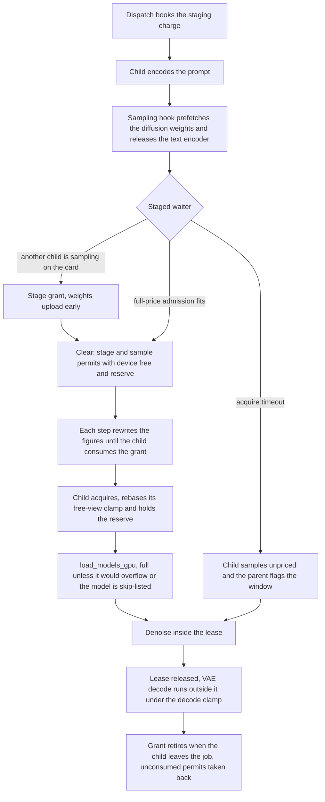

# Clearance and child loads responsibility map

Under the clearance lease a dispatch only stages a job. The child encodes its prompt and then waits inside the
sampling hook until the parent grants it a window. The grant is the moment the job's VRAM is committed. The
parent's `ClearanceController` decides which staged children are cleared, prices each at full cost, and writes
two figures beside the permit, the device free memory and the activation reserve. The child, in hordelib and the
ComfyUI copy hordelib vendors, sizes its load against those figures. It releases its text encoder before the wait,
rebases its view of free memory on the grant, keeps the reserve free and decodes outside the lease. This page lists
the one owner of each decision from dispatch to the end of the sample. The reasoning behind each rule is in
[VRAM arbiter](../explanation/vram_arbiter.md), [Admission pipeline](../explanation/admission_pipeline.md) and
[Resource governance](../explanation/resource_governance.md).

Worker paths are under `horde_worker_regen/process_management/`, `InferenceScheduler` is in
`scheduling/inference_scheduler.py`, and `ClearanceController` and `ClearanceLeaseProxy` are in
`scheduling/clearance_lease.py`. hordelib paths are under `hordelib/execution/` in the hordelib repository unless
stated.

## One job from dispatch to retirement

## Who is cleared, and when

Runtime capacity changes belong to `HordeWorkerProcessManager._apply_resize_capacity`, through the
supervisor's `RESIZE_CAPACITY` command. Intake must be paused and all image and alchemy work
finalized. Inference children must be idle, with all inference permits and clearance grants
returned. Normal RAM/VRAM process sizing still applies.
`ipc/inference_gate.py::ResizableInferenceGate` changes shared capacity in place, so existing
children keep the same gate. `ClearanceController.resize_slots` changes only an idle controller. The
live concurrent-inference cap also bounds grants (`ClearanceController.effective_slot_cap`) without
a resize. `ProcessLifecycleManager.resize_card_target` handles pool scaling. The correlated
acknowledgment includes whether a refusal is transient and may be retried.

| Decision | Owner | Rule |
| --- | --- | --- |
| Whether a staged child may sample | `ClearanceController.step`, `decide_clearances`, `_clear`; verdict `decide_clearance_admit` (`scheduling/admission/clearance.py`) through `InferenceScheduler.clearance_admit_process`; `VramArbiter.evaluate` | At most the slot cap of grants are held at once, and the free places go to the staged waiters closest to the head, so queue position decides who samples next. A chosen child is cleared only when its full-price admission fits the card now, and that admission runs eviction as a side effect. An idle child with a stage permit gets the stage and sample permits in one clear, so it does not wait twice. |
| When the parent may grant | `ClearanceWaiter`, built for a slot that `is_staged_short_of_sampling` (`lifecycle/process_info.py`) | A dispatched job's slot is a waiter from the dispatch until it reports a sampling state that began after the dispatch, so a grant can reach the child before the child's job start. A disaggregated job's pinned sampler is a waiter only once it reports `INFERENCE_PRIMED`. |
| Staging one child ahead | `ClearanceController._stage_head_waiter`, `_clear_stage`; verdict `decide_clearance_stage_admit` through `clearance_stage_admit_process` | While a grant on the card is sampling and none is staged or cleared, the idle waiter closest to the head gets its stage permit when the stage admission fits. Its weights land beside the running peak, and the next sample grant goes to the child already holding them. At most one child per card is staged ahead, and a refused head is asked again on the next step. |
| The tail-overlap handoff | `decide_clearances`, `_evaluate_tail_overlap`; setting `gpu_sampling_lease_tail_overlap` | With no stage admission the controller may add one grant beyond the cap for one handoff, timed so the incoming child's upload falls inside the outgoing sampler's tail, and refused below `_TAIL_OVERLAP_MARGIN_MB` of headroom. A stage admission replaces the handoff. |

## The figures a grant carries

| Decision | Owner | Rule |
| --- | --- | --- |
| The free figure | `InferenceScheduler._measured_device_free_mb`, netted per step by `_grant_charge_mb` and `_free_after_earlier_grants_mb` | Each child cleared in one step gets the device reading less what the children cleared before it in that step take (their weights plus reserve, capped at the figure), so the figures handed out in one step sum to the card's free memory. Children cleared together would otherwise each read the whole figure and load into the same room. The figure is not net of the child's own charge, since the child's clamp subtracts its own allocator growth. |
| The reserve | `pricing.sampling_reserve_mb`, raised to ComfyUI's inference reserve through `resource_budget.effective_inference_reserve_mb`, which mirrors hordelib `hordelib/vram_planning.py` `compute_inference_reserve_mb` | The reserve is the job's predicted activation raised to ComfyUI's inference reserve, or that reserve alone when the activation cannot be predicted, so it is at least ComfyUI's reserve whenever the card total is known. It travels on the staged waiter to both permits. |
| Figures of a grant not yet consumed | `ClearanceController._refresh_unconsumed_grant_figures`, through `ClearanceLeaseProxy._parent_refresh_grant_figure` and `_parent_refresh_stage_figure` | Each step with a reading rewrites the device free and the reserve of every grant the child has not consumed, holding the permit across the write so the child reads the new figures. The child consumes a grant seconds after it, once its encoder is off the card and siblings have unloaded, and a figure frozen at the grant would understate the card. The rewrite is the raw reading, so a child that has not consumed its grant by the next step reads a figure without the same-step netting. The `time.monotonic()` of the reading behind the device free is written and rewritten beside it, and is unset when there is no reading. |
| Figures at the child's job start | `ClearanceLeaseProxy.begin_job`, called from `workers/inference_process.py` | The four shared figures and both consumed flags reset at job start, because a permit released after the previous job timed out stays available and its figure describes the card before the previous job sampled. A grant issued before the job start carries its figures again from the next step's rewrite. A child that acquires before that rewrite reads both figures unset, and samples without the clamp rebase and with ComfyUI's own reserve estimate. |
| A grant that retires unsampled | `ClearanceController._reconcile_grants`, `_retire_grant`; `ClearanceLeaseProxy._parent_reclaim_unconsumed_permit`, `_parent_reclaim_unconsumed_stage_permit` | A grant retires by job correlation once its child leaves the staged and sampling states for the granted job. The parent takes back a sample permit the child never consumed and any untaken stage permit, so the next job on the slot does not acquire a stale grant. |
| How long a child waits for a grant | `CLEARANCE_LEASE_ACQUIRE_TIMEOUT_SECONDS` (60 s) | Past the timeout the child samples without a grant, and `_reconcile_grants` flags the window once as unpriced and counts it against the slot cap. A staged child seen sampling without its sample grant is flagged the same way. The timeout sits below the step-timeout kill deadline, so a clearance-starved child resumes its step heartbeats before it can be taken for hung. |

## The price and the bookings

| Decision | Owner | Rule |
| --- | --- | --- |
| The clearance price | `staged_sampling_peak_mb`, `staged_materialization_delta_mb` (`scheduling/admission/clearance.py`) | A monolithic job is priced at its diffusion weights plus the sampling reserve, net of what its slot already holds. The text encoder is off the card through the window and the VAE loads with the decode, so neither is charged. A disaggregated sampler, or a job whose weights or reserve cannot be predicted, keeps `pricing.candidate_delta_mb`. The decode tail is not priced. |
| The dispatch booking | `pricing.dispatch_staging_charge_mb` and `overlap_staging_charge_mb`, both through `pricing.staging_charge_mb`; `InferenceScheduler._upgrade_dispatch_reservation_to_full` | Under the clearance lease a dispatch books only the encode, which is the family's support weights plus `STAGING_ENCODE_ALLOWANCE_MB`, floored at the SDXL figure. Beside running samplers that charge holds only while every sampler's remaining seconds is known and the longest of them plus the card's measured load seconds fits the acquire timeout twice over, and the full price applies otherwise. A stage grant re-books the entry at the staged weights, and clearance re-books it at `staged_materialization_delta_mb`, which excludes the encoder. When the clear comes before the child's encode, the encoder loads with no booking. |
| Sibling relief | `sibling_staging_relief_mb` | A staged, uncleared sibling on the card that has entered its clearance wait (`clearance_wait_entered`) has finished its encode, so its whole outstanding charge is netted from the job being priced. A sibling still encoding stays charged the staging charge less what it holds, and a cleared sibling keeps its charge. This is the only reader of `clearance_wait_entered`. |
| The partial-load seat | `VramArbiter._partial_seat_admission`, `pricing.partial_seat_mb` | An extra-large checkpoint the card cannot hold whole is admitted at a share of its weights plus the larger of its non-weight memory and ComfyUI's reserve, and only once the card has nothing left to reclaim. A LoRA job never qualifies, and neither does a job on a card whose driver is paging the worker's allocations. The booking is capped at the granted room. The seat is an admission threshold, and the child's load is bounded by the grant figure less the reserve. |

## The child's load

| Decision | Owner | Rule |
| --- | --- | --- |
| The encoder leaves the card before the wait | hordelib `sampling_lease._release_text_encoders_before_wait`, `_text_encoder_still_needed` | Whenever a sampling lease is set, each text encoder on the sampling device is unloaded whole before the acquire, unless a node of the prompt still to run takes it. The diffusion load then has no encoder to partially unload, and the encoder's room is free while the job waits. `staged_sampling_peak_mb` relies on this. In a rung-1 run the encoder reload for each job goes through ComfyUI's `free_memory`, which can page part of the kept diffusion copy out of the card. The clearance price credits the resident weights and does not charge that re-read. |
| CPU-origin retention | hordelib `cpu_weight_retention.py` (`stash_cpu_origins`, `restore_cpu_origins`, `release_copied_back_weights`), called from `comfy_patches.py` | An unloaded weight is pointed back at its recorded CPU origin instead of being copied back from the device, so a released component restores from host RAM for the next encode. |
| Weight prefetch | worker `InferenceScheduler.warm_idle_lanes` (child `warm_model`); hordelib `sampling_lease._prefetch_sampling_model_weights` | After the dispatch pass, idle lanes holding a pending job's model read their reclaimed checkpoint pages back. In the child the hook starts a background page-in of the sampling model's weights before the lease wait, so the disk read of a mapped checkpoint overlaps the wait instead of the sampling window. |
| What the lease brackets | hordelib `install_sampling_lease_hook` on `comfy.samplers.CFGGuider.sample`, and the stage lease in `sampling_lease.py` | The lease brackets the stage upload, the sampling model's load and the denoise. The encoder load, the encode and the VAE decode run outside it. Every ComfyUI sampling path reaches `CFGGuider.sample`, and a hook on either `comfy.sample` entry point would leave one path sampling outside the lease. |
| The reserve the child keeps free | hordelib `sampling_lease._bound_by_sampling_reserve`, wrapping `comfy.sampler_helpers.estimate_memory` | ComfyUI's two memory estimates are raised to the granted reserve. `load_models_gpu` adds `extra_reserved_memory()` on top, and `sampling_reserve_mb` already includes ComfyUI's inference reserve, so the child keeps that constant more free than the price assumes. |
| The free view the child sizes a load against | hordelib `comfy_patches.free_memory_view_clamped`, rebased on each grant by `rebase_free_memory_view_clamp` through `sampling_lease._rebase_clamp_on_grant` | Within a run ComfyUI's free total is the lower of its own answer and the host figure less this process's allocator growth, plus the free memory inside torch's reserved pool. A rebase replaces the figure with the grant's and takes the allocator's reservation at that moment as the new baseline. Memory the child uploaded after the parent's reading and before the rebase is in neither term, so under a stage grant a sample-grant figure read before the staged upload overstates the room, and ComfyUI sizes the remaining load from the inflated view. |
| Whether a sampling load is forced full | hordelib `comfy_patches._load_models_gpu_hijack`, `_force_full_load_would_overflow_vram`, `_partial_load_allowed` | `load_models_gpu` is forced to a full load unless a model in the load is on the skip list or the bytes still to load, with the held reserve, would not fit the free view. A forced full load beyond free VRAM crashes ComfyUI natively instead of offloading. A skipped load runs ComfyUI's own partial load with no forced eviction of other models, and the `ModelPatcher.load` hijack lets that partial load stand. |
| Decode working memory | hordelib `_load_models_gpu_hijack` (the `comfy.small_model_working_clamp` line) and `_free_memory_capped`; ComfyUI's tiled decode fallback | For a load of support models up to `SMALL_MODEL_WORKING_CLAMP_MAX_BYTES` the caller's working estimate is zeroed and `free_memory` is capped near the loaded weights, so a VAE load does not evict the job's diffusion weights. The decode runs on free room, and on a true OOM ComfyUI falls back to tiled decoding. |

## Limits of what can be read from a log

- hordelib returns without a log line when an acquired grant carries no figure, so whether a child acquired before
  the rewrite that follows its job start cannot be read from a bundle.
- The parent's clear line does not carry the figures it wrote, and the child logs the rebase figure at DEBUG
  without the age of the reading behind it. Whether a stale sample-grant figure came from the device reading
  lagging or from a parent loop stall cannot be read from a bundle.

## Where to read next

- [VRAM arbiter](../explanation/vram_arbiter.md): the decision pipeline, admission authority and the partial-load
  seat.
- [Admission pipeline](../explanation/admission_pipeline.md): where each clearance decision lives and what it reads.
- [Resource governance](../explanation/resource_governance.md): the committed reserve ledger the dispatch bookings
  are held in.
- [Logs](logs.md): VRAM admission diagnostics.
- [Log findings](log_findings.md): `unpriced_sampling_windows`, `stage_outlived_sample_grant`, `stage_refusals`,
  `oom` and `swallowed_oom`.
- [Runs and residency responsibility map](responsibility-map-runs-and-residency.md): what holds the card before a
  job reaches clearance.
