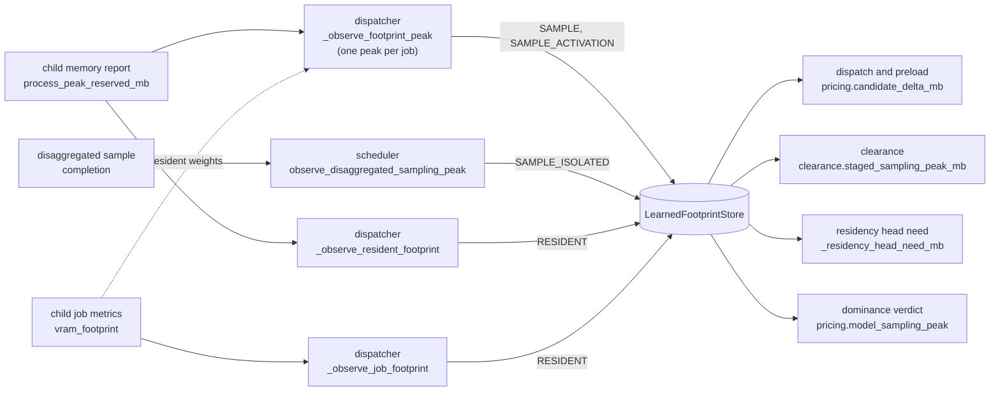

# Footprint and pricing responsibility map

The learned footprint store records what a model costs a card, so admission can price work from what the hardware
did rather than from static seeds alone. Children report allocator peaks and per-job footprints, and feeders in
the parent attribute each reading to a job and a key. The store bounds the readings and keeps a raise-only watermark
and a recent window per key. From them it gives two prices per key, the seed raised by the watermark and the
margined measured figure once a key has enough jobs. Four readers price one job from the store, each for a different
decision (dispatch and preload, clearance, the residency head need and the dominance verdict). The foreign floor and
the reconciler's baseline sit beside the store and are measured from the card. The reasoning behind the
rules is in [VRAM arbiter](../explanation/vram_arbiter.md) and
[Resource governance](../explanation/resource_governance.md).

Paths are relative to `horde_worker_regen/process_management/`. `pricing` is `scheduling/admission/pricing.py`, the
store is `LearnedFootprintStore` in `resources/vram_footprints.py`, the dispatcher is `MessageDispatcher` in
`ipc/message_dispatcher.py`, and the scheduler is `InferenceScheduler` in `scheduling/inference_scheduler.py`.

## Feeding the store

A sampling key is a baseline, a resolution band, a platform and a stage, optionally narrowed to a job class (batch
size, hires fix). An at-rest key is a checkpoint. Every feeder files a reading under the job's own model, because a
lane still swapping reports the previous model's allocator high-water.

| Decision | Owner | Rule |
| --- | --- | --- |
| Which key a monolithic sampling reading is filed under | dispatcher `_observe_footprint_peak` | The key's baseline comes from `job.model`. A reading is dropped while the lane holds another model, while the lane is `INFERENCE_PRIMED` (its encode working set alone would lower the price), or when the job is not in progress, since the first attributed reading fixes the job's key. |
| How many observations one job makes | `_JobSamplingPeak`, `_commit_job_sampling_peak`, `_commit_ended_job_sampling_peaks` | A child sends several reports per job, so the readings fold into one running maximum that commits once when the job ends, and the 20-entry window counts jobs. A job that leaves progress without a result commits on the next report. |
| What counts as activation | `_commit_job_sampling_peak` through `_JobSamplingPeak.sampled_with_weights_whole` | A job whose measured resident weights show the checkpoint was on the card whole also commits its peak less those weights under `SAMPLE_ACTIVATION`, bounded by its sampler-only seed. A partial load does not commit an activation figure, because its peak carries streamed weights that would read as activation and push later seats deeper into partial loads. |
| Which key a disaggregated sampler reading is filed under | scheduler `observe_disaggregated_sampling_peak` | The job's `SAMPLE_ISOLATED` key, kept apart from `SAMPLE` so a monolithic peak cannot raise the isolated sampler's price. |
| Which key an at-rest reading is filed under | dispatcher `_observe_resident_footprint` (idle, settled slot with the weights resident); store `observe_job_footprint` (job metrics) | The checkpoint's `RESIDENT` key, in whole-device terms with the context included. |
| Whether a sampling reading is plausible | `resources/vram_footprints.py` `plausible_sampling_peak_mb`, checked per reading in the feeder and again at commit | A reading above the band's heaviest seed x 1.25 plus the context charge, capped at the card, is dropped. A `SAMPLE_ACTIVATION` key is bounded by the band's heaviest sampler-only seed. A child that overflows the card or caches another checkpoint reports card-sized figures, and the watermark only rises. |
| Which stored readings survive a load | `FOOTPRINT_STORE_SCHEMA_VERSION` (5), `_MISKEYED_SAMPLING_SCHEMA_VERSIONS`; `LearnedFootprintStore.sanitize_sampling_observations`, called by the scheduler with `max_batch` | A file of schemas 2 to 4 loads without its `SAMPLE` and `SAMPLE_ACTIVATION` entries, since older feeders filed them under the lane's model and a clamp cannot remove a misfiled figure below the bound. `SAMPLE_ISOLATED` and the at-rest stages load as written. The sanitiser then clamps every sampling window and watermark to its bound. |

## Reading a key

| Decision | Owner | Rule |
| --- | --- | --- |
| The raise-only price | `LearnedFootprintStore.estimate_mb` | The static seed raised by the key's watermark, and the seed alone for a cold key. |
| The measured price | `measured_estimate_mb`, `measured_estimate_net_of_context_mb` | `None` until the 20-entry window holds 5 entries. A per-job stage prices at the window's second-highest entry, so one outlier job cannot set the price while two can. An at-rest stage prices at the window's maximum. Either is multiplied by 1.10 and has the platform context charge added. |
| The measured price of a job class | `measured_job_estimate_net_of_context_mb` | The class key's figure once it has 5 jobs, else the pooled band key's. |

## Pricing a job

| Decision | Owner | Rule |
| --- | --- | --- |
| What a dispatch or preload prices a job at | `pricing.candidate_delta_mb` through `pricing.learned_sampling_peak_mb`; the scheduler's copy `_learned_sampling_peak_mb` | The seed raised by the watermark, lowered by the class-else-pooled measured figure plus the LoRA delta, never below the job's core weights. A disaggregation-class job, or one beside an extra-large co-tenant, prices its `SAMPLE_ISOLATED` key. Weights already resident on the target are credited. |
| What a staged job is priced at clearance | `scheduling/admission/clearance.py` `staged_sampling_peak_mb` with `pricing.sampling_reserve_mb` | A monolithic job is its diffusion weights plus its activation raised to ComfyUI's inference reserve, since hordelib releases the text encoder before the clearance wait and the VAE loads with the decode. A disaggregation-class job, or one whose weights or reserve cannot be predicted, falls back to `candidate_delta_mb`. |
| What a residency head needs | scheduler `_residency_head_need_mb` through `_sampling_peak_mb` | The heaviest queued or running job of the model at its whole-job `SAMPLE` price, or at its partial seat when the price exceeds the room and the seat fits it. |
| A rung-2 model's seat | `pricing.partial_seat_mb` with `partial_seat_activation_mb` | A share of the weights plus the class-else-pooled `SAMPLE_ACTIVATION` figure raised to ComfyUI's reserve, the static seed until the key is measured. The watermark is not read, because a grant carries this figure as room the child must leave free. A LoRA job does not qualify for a seat, and neither does any job on a card under WDDM paging. |
| A staged job's dispatch booking | `pricing.staging_charge_mb`, `dispatch_staging_charge_mb` | Under the clearance lease a dispatch books the family's support weights plus 348 MB, at least SDXL's figure, because a family with lighter support weights still allocates the encode working set. |
| Who nets a staged sibling's booking | `clearance.sibling_staging_relief_mb` | A sibling in its clearance wait has finished its encode and is netted whole. One still encoding stays charged the staging charge less what it holds. A cleared sibling keeps its whole charge, since it is about to load its weights. |
| Whether a lane keeps its weights | scheduler `_retention_fit` through `VramBudget.check_job` | The static sampling seed (sampler-only for a disaggregation-class job) against the reported card total less the static tenants, the retained residents, the committed reserve and the foreign floor. It does not read a learned figure or measured free, since the driver's free figure cannot be trusted under WDDM paging. |
| A checkpoint's at-rest figure | `pricing.learned_resident_footprint_mb`, `measured_resident_footprint_mb`; scheduler copies `_learned_resident_footprint_mb`, `_measured_resident_footprint_mb` | The learned figure is the `RESIDENT` watermark less the context constant. The measured figure is offered only for a model that has produced a result on this worker, so a model is not declared small before it has run. |

`SchedulingSnapshot.models_with_results` is `JobTracker.has_model_produced_result` restricted to the models a slot
holds or a job names, so the pricing copy and the scheduler copy of the at-rest gate agree for every model either
prices. The scheduler copies re-implement the `pricing` helpers, and a change to one rule has to land in both.

## The dominance verdict

| Decision | Owner | Rule |
| --- | --- | --- |
| The figure the verdict prices a model at | `pricing.model_sampling_peak` | The measured figure of the baseline's pooled `SAMPLE` key at its most-observed band, else the static seed of a plain batch-1 job at that band (or at `DOMINANCE_SEED_BAND`). The watermark is never read, since it carries card-sized child peaks and would price a model off the card on one reading. |
| The verdict's rung and its hysteresis | `pricing.dominance_rung`, `decide_card_dominance`, `DOMINANCE_HYSTERESIS_MB` (256 MB); scheduler `card_dominance` | Rung 2 when the peak, both contexts, the foreign floor and the margin exceed the card. Rung 1 when no offered partner, the model itself included, fits beside it. A held rung moves only when the slack crosses zero by more than 256 MB, so a peak drifting about a threshold does not flip the teardown. |
| Whether a model wants the whole card | `pricing.forecast_streaming` (`wants_whole_card`) | True for an operator pin or a rung-2 verdict. |

The verdict reads the pooled key, which holds batched and hires-fix jobs, while its seed branch prices a plain
batch-1 job. One batched job can therefore move every model of a baseline to a higher rung, while
`candidate_delta_mb` prices the job's own class.

## VRAM the worker does not hold

| Decision | Owner | Rule |
| --- | --- | --- |
| The foreign floor | `resources/foreign_vram_floor.py` `ForeignVramFloorTracker`, `floor_with_known_tenant_mb`; scheduler `_sustained_foreign_floor_mb`, `current_foreign_floor_mb` | The minimum of positive `total - free - worker footprint` readings over a trailing 120 s, withheld until the window has filled and raised to a managed tenant's footprint. A spike does not lower the ceiling, and a reading at or below zero is the worker's own over-charged footprint, so it is not a sample. Read by the arbiter ceiling, `achievable_ceiling_mb`, the verdict, retention, `unpausable_tenancy_mb`, the whole-card claim and safety placement. |
| Unattributed VRAM for serviceability | scheduler `serviceability_baseline_mb` | The reconciler's shared-device baseline (`HordeWorkerProcessManager.latest_baseline_estimate_mb`) raised to a managed tenant's footprint. Read by `model_serviceability_verdicts` for the pop offer and the preload gate's unserviceable-job fault. |
| Unattributed VRAM for the arbiter | scheduler `_admission_baseline_mb` | The same reconciler baseline without the tenant raise, 0 before one is captured, as the arbiter's `baseline_mb`. |

The foreign floor and the reconciler baseline are separate measurements of the same memory, and each decision reads
the one named above.

## Limits of what can be read from a log

- The monolithic feeder's drop of a reading taken while the lane holds another model logs at TRACE, and the
  counter `MessageDispatcher.footprint_readings_on_other_model` is not logged or reported, so a default log does
  not show how many readings were dropped.
- A key's window and watermark are visible only in the persisted store (`vram_footprints.json`).

## Where to read next

- [VRAM arbiter](../explanation/vram_arbiter.md): the learned-footprint feeder and schema passages and the
  dominance verdict under "The four layers", then
  [The partial-load seat](../explanation/vram_arbiter.md#the-partial-load-seat) and
  [Cross-job retention](../explanation/vram_arbiter.md#cross-job-retention).
- [Resource governance](../explanation/resource_governance.md#whole-card-residency-state): what the verdict's
  rungs open.
- [Runs and residency responsibility map](responsibility-map-runs-and-residency.md): the readers of the rung.
- [Logs](logs.md#vram-admission-diagnostics) for the hold lines that carry each price, and the
  `whole_card_residency_churn`, `residency_reconciliation_holds` and `vram_pressure` findings in
  [Log findings](log_findings.md).
