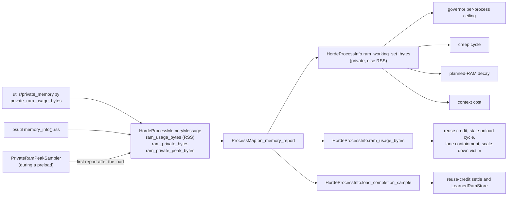
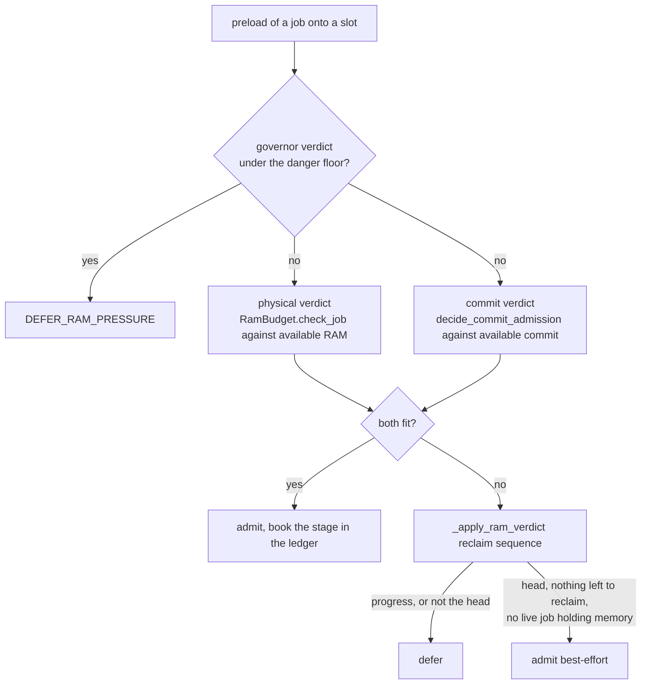
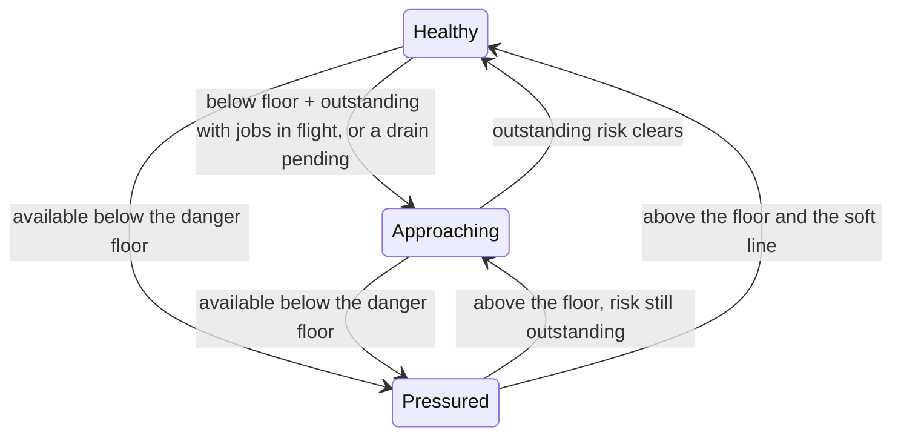

# Host RAM responsibility map

The worker keeps host memory above an absolute danger floor so a load does not route its weights through an
exhausted host. Each child reports two readings of its own memory, the resident set and a private working set that
leaves out reclaimable mapped checkpoint pages, and the parent decides from them which process to drain, recycle or
cycle and how much admitted RAM has landed. The parent measures the host's own figures, physical available RAM
and, on Windows, available commit. A preload is admitted only when two verdicts agree, one against physical RAM and
one against commit, because a mapped checkpoint charges commit in full at map time while it consumes almost no
physical memory. Once per control-loop iteration the governor reads the host against the floor and the soft hold
line and applies the response for its tier. The reasoning behind the rules is in
[Resource governance](../explanation/resource_governance.md) and
[Admission pipeline](../explanation/admission_pipeline.md).

Paths are relative to `horde_worker_regen/process_management/`. The scheduler is `InferenceScheduler` in
`scheduling/inference_scheduler.py`, the governor is `scheduling/governance/ram_governor.py`, the budget is
`RamBudget` and the ledger `CommittedReserveLedger` in `resources/resource_budget.py`, and the reclaim module is
`scheduling/ledgers/ram_reclaim.py`.

## The child's report

| Decision | Owner | Rule |
| --- | --- | --- |
| What the private figure measures | `utils/private_memory.py` `private_ram_usage_bytes` | The kernel's private working-set counter: `RssAnon + RssShmem` from `/proc/<pid>/status` on Linux, `PROCESS_MEMORY_COUNTERS_EX2.PrivateWorkingSetSize` on Windows for the current process. A walk of the pages (the `smaps_rollup` maximum of `Anonymous` and `Private_Dirty` on Linux, USS elsewhere) is the fallback, because its cost grows with the working set and on Windows it holds the GIL for the whole read. Mapped checkpoint pages stay out of the figure, and written copy-on-write and pinned host pages stay in. |
| When a report is sent | `lifecycle/horde_process.py` `HordeProcess.send_memory_report_message`, `_memory_reporter_loop` (`MEMORY_REPORT_INTERVAL_SECONDS`, 5 s); the inference child's report sites in `workers/inference_process.py` | A reporter thread sends one every 5 s whatever the main thread is doing, and the inference child sends more at its state changes and stage boundaries. Every report carries both RAM readings. |
| A load's peak | `PrivateRamPeakSampler` around the preload in `HordeInferenceProcess`; `PEAK_SAMPLE_INTERVAL_SECONDS` (0.1 s) | The sampler polls the private figure while the preload runs, and the first report after `PRELOADED_MODEL` carries the highest reading, since the settled figure can sit below the transient the load touched. |
| What the parent keeps | `lifecycle/process_map.py` `ProcessMap.on_memory_report`; `lifecycle/process_info.py` `HordeProcessInfo.ram_working_set_bytes`, `LoadCompletionSample` | Each report overwrites both readings, a missing private figure included, and `ram_working_set_bytes` falls back to RSS when it is missing. A report that carries a peak becomes the process's `LoadCompletionSample`. |

## Who reads which figure

Every consumer reads the latest report and compares it with a threshold in gigabytes or with a difference of two
readings of the same process. Consumers that must not count mapped checkpoint pages read the private figure.

| Decision | Owner | Figure | Rule |
| --- | --- | --- | --- |
| A process over the per-process ceiling | `ram_governor.decide_over_ceiling_reclaim` through `InferenceSlotSnapshot.resident_ram_mb`; ceiling from scheduler `_ram_per_process_ceiling_mb` | private | Only under the danger floor, the largest process at or above the ceiling is recycled when idle and marked draining when busy. The ceiling is the larger of `ram_per_process_max_mb` and the largest offered context seed x 1.1 plus 1,100 MB, so a healthy fp8 process is not recycled for its mapped pages. |
| A slot that has crept | `ram_reclaim.select_ram_cycle_victim` (`RamCycleReason.CREEP`), driven by scheduler `_replace_stale_ram_unload_process` | private | An idle inference slot at or above the model-aware ceiling is cycled ahead of any stale-unload victim, the staging target included. |
| How much admitted RAM has landed | `CommittedReserveLedger.effective_planned_ram_mb` from scheduler `_outstanding_planned_ram_mb` | private | Each planned entry decays by its target's private growth since admission, and the decay only rises, so pages a load releases do not resurrect its charge. |
| What a restored context costs | scheduler `_estimated_resident_context_ram_mb` | private | The largest private figure among inference processes, else the largest offered context seed. |
| A load's learned price | `RamReclaimLedger.settle_credits` into `resources/ram_footprints.py` `LearnedRamStore` | load-completion sample | An admission learns only from the sample that completed its own load (same launch, same model, sampled after the admission), and is dropped unlearned after `LOAD_COMPLETION_REPORT_TIMEOUT_SECONDS` (600 s). A peak more than 2,048 MB over its charge logs a discrepancy. |
| The pages a swap can reuse | `ram_reclaim.staging_reuse_credit_mb` | RSS | An idle target's RSS above the 1,100 MB cold-child baseline, and zero until a reading postdates the last RAM unload. |
| A slot that kept a freed model's pages | `select_ram_cycle_victim` (`RamCycleReason.STALE_UNLOAD`) | RSS | A model-less idle slot whose last control flag is the RAM unload, on a reading after that request, above the cold-child baseline plus the larger of 2% of host RAM and 512 MB, at most once per slot every 120 s. The head's staging target is exempt. |
| An idle service lane holding too much | `ram_reclaim.idle_lanes_over_ram_ceiling`, scheduler `_contain_idle_lane_ram` | RSS | An idle component or VAE lane at or above 10 GB is sent `UNLOAD_MODELS_FROM_RAM`, at most once per lane every 180 s, every governance tick. |
| Which slot a pressure scale-down stops | lifecycle `_select_inference_process_to_scale_down` | RSS | The smallest idle slot whose RSS covers the shortfall below the floor, else the ordinary victim choice. |

## The two admission verdicts

| Decision | Owner | Rule |
| --- | --- | --- |
| No load while under the floor | `scheduling/admission/preload.py` `decide_preload_gates` (`DEFER_RAM_PRESSURE`) | A preload is deferred when the tick's verdict is under the danger floor, because every load routes through host RAM. |
| The physical-RAM verdict | `preload.decide_ram_admission` through `RamBudget.check_job`, against `HostRamSnapshot.available_mb` | Available RAM less the committed reserve, the outstanding planned RAM and the charge must keep `max(floor, ram_reserve_mb)`. The charge is the job's feature RAM plus one of three accountings: the UNet-only component charge for a disaggregation-class job with a sidecar, the learned swap growth once trusted for a swap onto a slot that kept its pages, or the checkpoint staging charge net of the reuse credit. |
| The checkpoint staging charge | scheduler `_checkpoint_staging_charge_mb` | The trusted learned `WHOLE` peak, else the file size, else the context seed, never below 3,500 MB. It is a resident-set figure and excludes feature RAM. |
| The reuse credit | `RamBudget.check_job` (`_MARGINAL_STAGING_CREDIT_FRACTION` 0.7, `_MARGINAL_STAGING_CHARGE_FLOOR_MB` 3,500 MB, `_MARGINAL_STAGING_TRANSIENT_HEADROOM_MB` 1,024 MB) | 70% of the reusable pages comes off the charge, never below 3,500 MB, and only when the credited charge plus 1,024 MB still leaves available RAM above the floor. |
| The commit verdict | `preload.decide_commit_admission` against `HostRamSnapshot.available_commit_mb` | The charge is the checkpoint's file size (`JobSnapshot.checkpoint_file_mb`, from scheduler `_checkpoint_file_mb`) plus the job's feature RAM, with no reuse or component credit, under the same reserve, floor, committed reserve and outstanding planned RAM. The verdict is skipped on POSIX, for a checkpoint of unknown size, and for a target that already holds the checkpoint. |
| Available commit | `scheduling/host_commit.py` `measure_available_commit_mb`, `page_file_growth_room_mb` | `GlobalMemoryStatusEx`'s `ullAvailPageFile` on Windows, the commit limit at the page files' current size less the commit charged, plus the space available for page-file growth. A configured maximum limits growth, as does the drive's free space. A system-managed file may use all free space on the drive because Windows does not apply the worker's low-disk floor. The `PagingFiles` registry value is read once per process, and a failed growth-room read leaves `ullAvailPageFile` alone. POSIX does not charge a private mapping to commit when it is mapped, so it reports `None`. |
| A RAM miss | scheduler `_apply_ram_verdict`; `scheduling/governance/preload_admission.py` `decide_ram_reclaim_outcome` | An idle-model unload under pressure, escalated for the head, then a cycle of a crept or stale slot other than the target. The outcome reads the reclaim results, never a fresh reading, and admits best-effort only a head blocker with no live job holding memory. |
| A host that refuses a mapping | child `_is_host_commit_error` in `workers/inference_process.py`; dispatcher `HOST_COMMIT_FAILED_INFO` handling; `JobTracker.handle_host_commit_refusal`, `MAX_HOST_COMMIT_REQUEUES` (3) | A refusal at preload reports `host-commit-failed`, does not count against the model or the slot, and leaves the load to be re-admitted. A refusal during the run requeues the job without spending an inference attempt, up to 3 times, then faults it for the horde to reissue. The budget is a plain count with no clock. |
| Which lane holds a model after a failed load | dispatcher `_handle_model_state_change` (the FAILED branch) through `ProcessMap.on_model_load_failed`; child `HordeInferenceProcess.preload_model` | A lane record lists a model only after a load report states that the lane holds it or is loading it. Every FAILED report, a host refusal or any other, expires the model-map entry and clears the lane record in the same step. Dispatch (`resident_process_for_job`) and the preload gate (`ALREADY_LOADED`) therefore do not read a refused model as resident, and a requeued job's load goes back through the host admission unless another lane holds the model. A record naming another model is kept, since a failure reported before any load began leaves the previous model in place. The child clears its active model once it has reported the previous one unloaded, so a later `START_INFERENCE` mismatch does not report a model name. |

## Booking admitted RAM

| Decision | Owner | Rule |
| --- | --- | --- |
| A preload's checkpoint stage | scheduler `_admit_and_send_preload` and `_send_preload` through `CommittedReserveLedger.set_planned_ram` (`PRELOAD_ADMISSION_FLOW`) | Booked against the target at its admitted accounting without feature RAM (`preload.preload_ram_stage_mb`), and dropped once the process leaves the loading set. |
| A job's sampling feature RAM | scheduler `_book_dispatch_reservation` through `set_planned_ram` (`DISPATCH_ADMISSION_FLOW`, `keep_progress=True`) | Booked against the inference process at dispatch and dropped when the job leaves inference. A re-booking at clearance keeps the entry's progress. |
| Post-processing and alchemy RAM | `workers/post_process_orchestrator.py` through `CommittedReserveLedger.set`; `jobs/alchemy_popper.py` `_sync_reserve_ledger` through `replace_flow` | Flat entries, counted in `total_ram_mb`, that do not decay. A post-processing entry lives while the chain runs, and an alchemy graph form's entry while the form is in flight. |

## The governor's tiers

| Decision | Owner | Rule |
| --- | --- | --- |
| The danger floor | `resources/resource_budget.py` `ram_pressure_floor_mb`, settings `ram_pressure_pause_percent` (85), `ram_pressure_min_free_mb` (1,024) | The larger of `(100 - pause_percent)%` of total RAM and the minimum, so each guards the host size the other misses. |
| The admissible figure | `assess_ram_pressure`, `RamPressureVerdict` | Physical available RAM lowered to available commit where the host reports one. A missing reading does not create pressure. |
| The thresholds | `resource_budget.ram_headroom`, `RamHeadroom` | The soft hold line is the floor plus outstanding RAM, never the reserve. Preload needs `max(floor, reserve)` plus outstanding plus the charge, and restore the same with a context in place of the charge. |
| When the governor runs | `scheduling/governance/governor.py` `ResourceGovernor.tick`, driven by scheduler `run_governance_tick` | Once per control-loop iteration whatever the queue holds, because a tick gated on a queue the pop hold drains would not run again to clear the hold. Per-job gates in the same cycle read the tick's verdict. |
| The soft pop hold | `ram_governor.decide_pop_hold` | Engaged while admissible RAM is below the soft line with jobs in flight, while under the floor, or while a process is draining, and released the tick the risk clears. Each tick with the hold also evicts idle models. |
| The degrade response | `ram_governor.decide_degrade_response`, `decide_process_reduction`, `RAM_PRESSURE_PAUSE_SECONDS` (30 s) | Under the floor the response pauses pops for 30 s, evicts idle models (unprotected staged components first, then a whole idle model, then a crept or stale slot cycle), sheds idle inference contexts (per card on a multi-GPU host, never emptying a card) and reclaims one over-ceiling process. |
| Draining marks after the episode | `ram_governor.decide_draining_followthrough` | On a recovered host a marked process is unmarked once under the ceiling or gone and recycled once idle, since the mark holds pops and restore until it resolves. New marks are placed only under the floor. |
| Shed contexts grow back | `ram_governor.decide_shed_restore` | On a healthy host with the pause lapsed and nothing draining, one context per card per tick, each charged the context estimate against the restore headroom. |
| A hold that outlives the pressure | coordinator `maybe_reset_stuck_governance_hold`, scheduler `governance_healthy_but_held`, `reset_governance_to_baseline`; `HEALTHY_HOLD_WATCHDOG_GRACE_SECONDS` (120 s) | A hold set on a healthy, idle, empty worker for the grace first resets governance to baseline and, if the hold re-latches, rebuilds the idle inference pool. It is not a wedge input, because the soft reset's pool churn would hit a healthy pool. |

## Limits of what can be read from a log

- The private figure cannot see commit. A mapping charges commit at map time while the private set counts only
  pages a load writes, and a CUDA context commits memory it does not touch. The outstanding planned RAM both
  verdicts subtract decays on the private figure, so on a commit-bound host it measures progress in a different
  quantity from the one the commit verdict compares.
- The throttled `Process N memory report` line and the per-role RAM breakdown carry RSS only, so the private
  figure a decision compared is not in the parent log.
- Available commit appears only in the danger-floor reason (`commit-bound; physical N MB`) and in the RAM verdict
  lines that name commit (`commit-bound: N MB committable`, `commit not priced`). The stats rows do not carry it.
  The logged figure includes the page files' growth room, so on a host whose page files can still grow it
  exceeds the current available commit reported by Windows.

## Where to read next

- [Resource governance](../explanation/resource_governance.md#the-governor-tick) for the tick, the admissible figure
  and the commit charge, then
  [Honest RAM accounting](../explanation/resource_governance.md#honest-ram-accounting-and-per-process-residency) and
  [Idle service-lane RAM containment](../explanation/resource_governance.md#idle-service-lane-ram-containment).
- [Admission pipeline](../explanation/admission_pipeline.md#where-each-decision-lives) for where the RAM verdicts sit
  among the preload gates.
- [Recovery and safety responsibility map](responsibility-map-recovery-and-safety.md) for the healthy-hold
  watchdog's place beside the wedge assessment.
- The `host_ram_starvation` and `model_churn` findings in [Log findings](log_findings.md).
