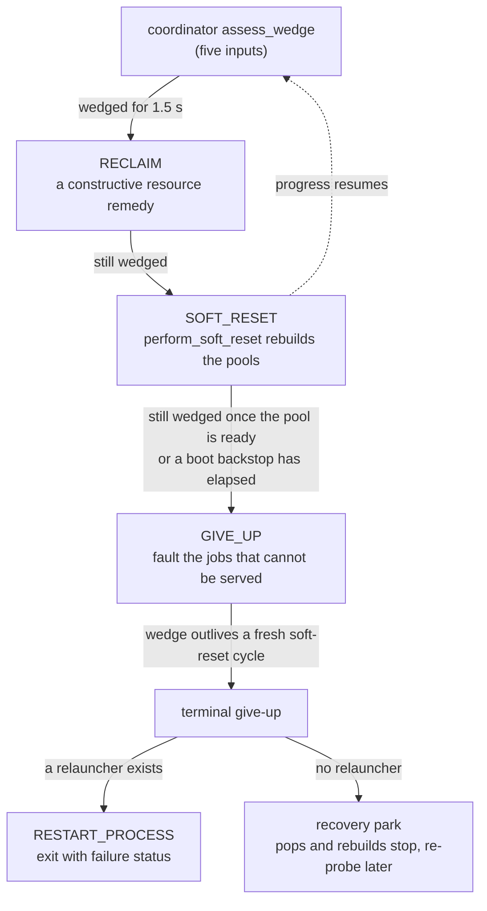

# Recovery and safety responsibility map

Recovery works in layers. The lifecycle replaces a single process that died or stopped reporting. The recovery
coordinator judges whether the worker as a whole has stopped making progress, and the recovery supervisor escalates
that judgement from a resource remedy to a soft reset and then to a give-up. Beside that ladder, one actuator moves
the safety process on and off the GPU for a named owner and one reconciler returns it. A per-check window can send a
single check to the CPU without moving the process, and an orphan watchdog recovers jobs whose verdict does not
return. The reasoning behind the rules is in
[Resilience and recovery](../explanation/resilience_and_recovery.md),
[Process lifecycle](../explanation/process_lifecycle.md), [VRAM arbiter](../explanation/vram_arbiter.md) and
[Process lanes and chaining](../explanation/process_lanes_and_chaining.md).

Paths are relative to `horde_worker_regen/process_management/`. The lifecycle is `ProcessLifecycleManager` in
`lifecycle/process_lifecycle.py`, the coordinator is `WorkerRecoveryCoordinator` in
`lifecycle/worker_recovery_coordinator.py`, the supervisor is `RecoverySupervisor` in
`lifecycle/recovery_supervisor.py`, and the scheduler is `InferenceScheduler` in
`scheduling/inference_scheduler.py`.

## Replacing one process

| Decision | Owner | Rule |
| --- | --- | --- |
| A dead child is replaced | lifecycle `_reap_if_crashed` | Death is definitive, so the reap is not debounced and does not read boot state. |
| A live inference slot is hung or broken | lifecycle `replace_hung_processes` (silence timeout widened by `_effective_inference_step_timeout`, the stuck-step watchdog, state timeouts through `_check_and_replace_process`, all-processes-timed-out), `_replace_faulting_inference_lanes` | Each branch has its own timer, and the branches share the `_recently_recovered` debounce. |
| A crawling sampler is killed as the last reclaim rung | lifecycle `_replace_if_paged_and_slow`, `SATURATION_KILL_MIN_SECONDS` (10 s); clock `HordeWorkerProcessManager._device_saturation_duration_seconds` | An `INFERENCE_STARTING` slot that crawls is replaced once the card has been continuously SATURATED for 10 s with the verified reclaim ladder unresolved, so a card a softer rung could still rescue is not killed. |
| A slot is replaced for another owner's reason | scheduler `clearance_admit_process` (refused outright), `unload_models_from_vram` (send failure), `_replace_stale_ram_unload_process`; `PlanExecutor.execute_commands`, `execute_governance_actions`; `HordeWorkerProcessManager._control_loop_tick` (maintenance), `_apply_supervisor_command` (operator) | Each calls lifecycle `_replace_inference_process` directly, whose only gate is the recovery park. These paths do not share the `_recently_recovered` debounce and `_replace_inference_process` does not guard a slot already in `PROCESS_STARTING`, so a new path reads boot and busy state itself. |
| A child ends on a handler exception | `lifecycle/horde_process.py` `receive_and_handle_control_messages` | Any exception from a supported handler ends the child, because a handler that failed mid-action leaves the process state unknown. A message the child does not support is dropped, since no handler ran. |

## Judging the worker wedged

| Decision | Owner | Rule |
| --- | --- | --- |
| The worker is wedged | coordinator `assess_wedge` | Any of five inputs, each with its own clock: the inference pool unrecoverable, the safety pool unrecoverable, a structural queue wedge, an orphan wedge, a pop-gate wedge. Shutdown, the downloads-only hold and the recovery park mask the assessment. |
| A queue deadlock is a structural wedge | coordinator `structural_queue_wedge_active`; dispatcher `DeadlockSnapshot.indicates_structural_wedge`, `_MIN_STRUCTURAL_QUEUE_WEDGE_SECONDS` (20 s) | The dispatcher's latch must hold for 20 s, measured from the later of the latch's start and the wedge clock's last restart. The clock restarts on every tick an excuse holds the queue (the residency grace, the residency governor's deferral, the heavy-head load grace, the RAM-reclaim cycle grace, a live dispatch hold, inference starts backing off) and on the tick an inference slot finishes booting. Inference in progress disproves the wedge. The latch keeps its age under an excuse, so without the restart a hold's end would read as a sustained wedge. |
| The save-our-ship action | `RecoverySupervisor.evaluate` | A wedge held 1.5 s earns the next constructive remedy, then one soft reset, then a give-up. While a replacement child is alive and booting (`live_boot_holds`), the give-up waits, up to the boot hard cap, so a stuck boot cannot mask the wedge. |
| The inference pool is rebuilt | coordinator `perform_soft_reset`, `maybe_reset_stuck_governance_hold`; lifecycle `rebuild_inference_pool` | A rebuild replaces every live inference slot, one in `PROCESS_STARTING` included. |
| The terminal give-up | coordinator give-up through `RecoveryDisposition` | With a relauncher the process exits with failure status. Without one the coordinator enters the recovery park (`enter_recovery_park`), which stops pops and rebuilds and re-probes after `RECOVERY_PARK_REPROBE_SECONDS`. |

## Safety-check jobs

| Decision | Owner | Rule |
| --- | --- | --- |
| How long a job may await a verdict | coordinator `_orphan_safety_grace_seconds`, `ORPHAN_SAFETY_GRACE_SECONDS` (45 s) | The baseline holds while safety runs on a GPU or no safety process is alive. With a live process off the GPU the grace is the average check x (3 + the safety backlog), at least the baseline and at most 300 s, because the lane is single-serial and a verdict waits for every check ahead of it. |
| A stranded job is requeued or faulted | coordinator `reconcile_orphaned_safety_jobs`, `SAFETY_REQUEUE_MAX` (3) | A job past the grace is requeued for a fresh check. After 3 requeues, or with the safety pool unrecoverable, it is faulted so the horde reissues it. A verdict dropped from a retired launch (`MessageDispatcher.take_safety_verdicts_known_lost`) skips the grace. |
| The safety process is replaced | lifecycle `_reap_if_crashed`, `_check_and_replace_process`; coordinator `reconcile_orphaned_safety_jobs`; `SafetyOrchestrator.start_evaluate_safety` (dispatch failure); the soft reset | A requeue asks for a replacement only when `is_safety_capacity_available` is false, since a busy process is progressing and replacing it discards its check. A job faulted after `SAFETY_REQUEUE_MAX` requeues asks for one while a process is live, since that watchdog is the only reader of safety-check progress. Neither asks while `safety_placement_transition_pending` holds. |
| Whether safety may take a check | coordinator `is_safety_pool_ready` | An idle process able to accept a check, read by intake and never as a replacement trigger. |

## Safety placement

The safety process is on its card with its weights resident, on its card with its weights demoted to host RAM, or
off the GPU. Every move goes through one actuator under a named `PauseOwner`, and the reconciler alone restores.

| Decision | Owner | Rule |
| --- | --- | --- |
| Safety leaves the GPU | scheduler `_reconcile_runtime_safety_placement`; lifecycle `pause_safety_on_gpu` with a `PauseOwner` | A whole-card residency (`WHOLE_CARD`), a reclaim-ladder request (`RECLAIM_LADDER`) and measured pressure held for the dwell (`RUNTIME_SAFETY_PLACEMENT`) are the owners, in that order of precedence. Under pressure the weights are demoted first while that is possible, and the process moves only if the pressure persists. A config reload that withdraws `safety_on_gpu` from the pinned card moves the process through `demote_safety_from_unpermitted_card`, and a deferred on-GPU start that stalls is started on the CPU instead (`_escalate_safety_start_off_gpu`). |
| A single check runs on the CPU | scheduler `safety_check_window`, `safety_check_patience_seconds` | A check whose growth the arbiter cannot seat waits with its booking standing and runs on the CPU after the patience, the measured CPU check time. The process does not move. The window reads VRAM only, not the host RAM verdict. |
| Safety returns to the GPU | scheduler `_reconcile_runtime_safety_placement`; lifecycle `restore_safety_on_gpu` | The restore is held while another owner asks for the card, a residency vetoes it, a shallow safety backlog drains on the CPU (not for a ladder pause), the post-processing backlog is deep, or the VRAM growth hold is on. A memory-pressure owner's pause also needs the restore dwell of forecast headroom. If the arbiter still withholds the load, the reconciler evicts the coldest idle resident not needed by queued work and asks again on the next cycle. |
| A move ends the safety process | lifecycle `end_safety_processes`, `_safety_end_waits_for_work`, `safety_replacement_armed`; `SafetyOrchestrator.start_evaluate_safety`; `AlchemyCoordinator.in_flight_form_ages`, `_safety_process_held` | Both directions end the process through the replacement machine. A live process running a safety check (the job tracker's current safety attempt) or a CLIP alchemy form (the alchemy coordinator's owner record) is sent its end request only after that work returns, and the machine retries the request on each tick. New checks and CLIP forms are not dispatched to it while the replacement is armed. A form holds the end for at most `process_timeout` from its dispatch. A check holds it until the verdict returns, the orphan sweep requeues it, or `process_timeout` passes, whichever is first. On the GPU the sweep's 45 s grace is below every `process_timeout` default, so 45 s is the bound on a check there. Off the GPU the grace scales up to 300 s and the shorter of the two applies. A dead process or a shutdown is not waited on. |
| The restore forecast | `scheduling/ledgers/safety_placement.py` `SafetyPlacementInputs.restore_headroom_fits`; scheduler `_safety_placement_marginal_need_mb`, `_sampling_peak_jobs_for_card`, `_resident_committed_mb_for_model` | Measured free must cover the safety footprint, the noise buffer and the marginal need on a HEALTHY card. The marginal need is the heaviest learned peak among the card's in-progress and eligible queued jobs, less what a lane already holds for that model, since readmitting on room the next peak takes back buys the next eviction. |
| The restore dwell | scheduler `_safety_placement_restore_dwell_seconds`; `SAFETY_PLACEMENT_RESTORE_DWELL_FACTOR` (2), `MEMORY_PRESSURE_PAUSE_OWNERS` | Twice the measured safety readiness latency (`safety_readiness_latency_seconds`, 30 s to 300 s), for pauses whose owner is `RUNTIME_SAFETY_PLACEMENT` or `RECLAIM_LADDER`, so safety leaves promptly and returns once room is durable. A whole-card residency's pause ends when its model drains. |
| Safety's weights return to the GPU | scheduler `_promote_safety_weights_if_room` | With no owner asking for the card, demoted weights are promoted on an unpressured card the arbiter admits, with no dwell, since a flip that keeps the process and its CUDA context is cheap. |

`MEMORY_PRESSURE_PAUSE_OWNERS` holds `RECLAIM_LADDER` whatever filed the ladder request, so a ladder pause taken for a
save-our-ship remedy earns the same dwell as a pressure eviction. The weight promoter does not read a settling
remedy, so a `DEMOTE_SAFETY_WEIGHTS` remedy's room can be taken back on the next cycle.

## Lanes held for a waiting job

| Decision | Owner | Rule |
| --- | --- | --- |
| A lane stays paused for a beneficiary | `resources/reclaim_ladder.py` `ReclaimLadder._unwind_restore_obligations`, `lane_pause_beneficiaries`; `HordeWorkerProcessManager._beneficiary_waiting` | The ladder asks whether the booked job still waits, with the paused lane's `ReclaimRungKind`. An inference beneficiary waits until its sample ends and a post-processing one until its chain leaves the lane. A job waiting for post-processing does not hold the post-processing lane paused, since that lane is the one that drains it. |
| A post-processing job waits for room | `workers/post_process_orchestrator.py` `PostProcessOrchestrator._age_out_unfittable`, `_ADMISSION_PATIENCE_SECONDS` (90 s) | A chain that cannot be admitted for 90 s is faulted, and the clock runs under a reclaim-ladder pause, because the ladder restores a lane only when the card reaches HEALTHY. |
| The image-utilities lane should be up | `scheduling/workload_flow.py` `utilities_lane_demand`; read by lifecycle `start_utilities_processes`, `reconcile_utilities_demand` and `restore_utilities_off_gpu` | Wanted for an alchemist offering annotation before any lane has reported a servable set (one start to get the set), a job in `PENDING_STRIP`, a strip-only job pending or in inference, a ControlNet pre-annotation candidate (extended-ControlNet jobs included) or a job in `PENDING_ANNOTATION`, or a lane-bound alchemy form pending or in flight. Every start path reads it, and the ladder's restore lifts its pause without starting a lane that no job needs. The per-tick driver starts the lane when demand appears and restores a ladder pause no owner still claims. |
| An extended-ControlNet job waits for the utilities lane | `process_manager.py` `HordeWorkerProcessManager._fault_unready_extended_controlnet_jobs`; lifecycle `utilities_lane_will_serve`; scheduler `InferenceScheduler.reconcile_utilities_lane_holds` and the `DispatchHoldLedger` | A job wanting pre-annotation of a type the lane cannot serve yet is held while the lane runs, starts or is down by policy and the type's annotator weights are on disk. Selection skips it, its empty slot is the `utilities_lane_bring_up` duty bucket, and the deadlock detector exempts it. It is faulted with `extended_controlnet_not_offered` once `dispatch_affinity.utilities_lane_hold_expired` reports its time spent (ttl from pop less expected sampling and the skip budget, or the anti-starvation share with no sampling figure), once a live lane reports a set without its type, or when the lane crashed, is paused or had its start refused. |
| A lane-bound alchemy form is offered and waits for the utilities lane | `jobs/alchemy_popper.py` `AlchemyCoordinator._utilities_lane_healthy`, `_utilities_lane_fault_cause`; `process_manager.py` `HordeWorkerProcessManager._utilities_lane_outlook`, `_alchemy_annotation_types`, `_kept_servable_set` | `strip_background` is offered while a lane is loaded or the lane will serve. `annotation` is offered with the live set, or with the set kept from the lane's last run while the lane will serve. A crash replacement or a disabled lane drops the kept set. A popped form with no loaded lane waits until `dispatch_affinity.utilities_lane_hold_expired` reports its time spent, with the dispatch deadline (`PENDING_FORM_DISPATCH_DEADLINE_SECONDS`, 300 s) as its ttl and no sampling figure, so after 90 s. It is faulted at once when the lane crashed, had its start refused or is disabled. A paused lane, and a loaded lane busy with another form, keep the dispatch deadline. |
| A background strip waits for and runs on the utilities lane | `process_manager.py` `HordeWorkerProcessManager._age_out_pending_strips`, `_PENDING_STRIP_TIMEOUT_SECONDS` (180 s), `_strip_stage_cap_seconds` | A dispatched strip is faulted after 180 s of running. A queued strip is clocked from the tick it reaches the head of the queue (no dispatched strip ahead of it) and faulted after 180 s there. Every queued strip is faulted once a fresh pass no longer fits inside the stage cap, one pass per job the worker admits to intake plus its own. Dispatch runs before the age-out in each tick, so a waiter is never faulted in the tick a lane frees for it. |
| The post-processing fault breaker counts a fault | `jobs/job_tracker.py` `JobTracker.note_post_processing_overcommit_fault`, `PostProcessingFaultCause` | Each fault site passes its cause, and only `VRAM_OVERCOMMIT` is counted. Strip latency, strip service failures, a lost strip lane and a disabled lane are faulted jobs that leave the count alone. |
| The post-processing offer depth | `jobs/job_popper.py` `JobPopper._post_processing_commitment_depth`, `_POST_PROCESSING_OFFER_COMMITMENT_LIMIT` (2) | Counts the jobs the post-processing lane will serve, once each: inference-queue jobs requesting an upscaler or face fixer, jobs pending or in post-processing, and the alchemy lane's commitments. Strip-only jobs and jobs waiting for their strip do not count. |

## Auxiliary files on disk

| Decision | Owner | Rule |
| --- | --- | --- |
| A LoRA or TI is on disk | The download process (hordelib's ad-hoc cache; `workers/download_process.py` `_aux_entry_present`) | The parent does not track presence itself. Every reference of a popped job that is not skipped or cooling is sent, and the download process reports a present entry as an immediate success after applying the request's pins. The result is recorded per job (`TrackedJob.aux_present_lora_keys`, `aux_present_ti_keys`) and withdrawn when a child fails to resolve a file. |
| Which LoRAs are protected from eviction | `models/aux_prefetch_coordinator.py` `AuxPrefetchCoordinator._current_pins`; `workers/download_process.py` `_apply_eviction_pins` | Every file a not-yet-terminal tracked job references is pinned. A version reference resolves through `find_lora_key_by_version` and a name through `fuzzy_find_lora_key`, since the fuzzy lookup reads a number as a model id. A file evicted before its job was popped is not held by a pin. |

## Limits of what can be read from a log

- The kill's clock runs only while the governor reads SATURATED, while the reclaim ladder also runs under PRESSURE
  when the per-step floor forces it. A ladder that ran to unresolved under PRESSURE therefore does not end in a kill. The
  run-metrics `RECLAIM_RUNG` decision records carry `forced_by_per_step_floor` and `saturation_unresolved`.
- A safety child that dies mid-check does not mark its jobs' verdicts known lost, so those jobs wait out the full
  grace before the requeue line appears.

## Where to read next

The inference permit counter belongs to `ipc/inference_gate.py::ResizableInferenceGate`. Its short
counter updates use an OS file lock released on process death, and blind recovery releases remain
bounded by the current capacity. The operator assessment shuts down its ordinary worker through the
supervisor. A wake signal prompts the waiter to recheck the permit counter. Every waiter does so at
least every 100 ms, even without an acquisition timeout. If a process dies after returning a permit
or consuming a signal, another waiter can still acquire the available permit. A rejected
over-release also sends a wake without increasing capacity. The assessment reaps only
creation-time-verified descendants from its isolated owned-PID registry if that worker exits or
times out. Its capacity changes follow the [clearance responsibility
map](responsibility-map-clearance-and-child-loads.md#who-is-cleared-and-when).

- [Resilience and recovery](../explanation/resilience_and_recovery.md#layer-3-save-our-ship-sos-escalation) for the
  supervisor and its boot backstops, and
  [Stranded safety-check jobs](../explanation/resilience_and_recovery.md#stranded-safety-check-jobs).
- [Process lifecycle](../explanation/process_lifecycle.md#process-replacement) for the replacement paths.
- [Runtime safety placement](../explanation/vram_arbiter.md#runtime-safety-placement) and
  [the kill as last rung][kill-rung].
- [Process lanes and chaining](../explanation/process_lanes_and_chaining.md) for the restore rule on paused lanes.
- [Host RAM responsibility map](responsibility-map-host-ram.md) for the host-memory remedies the governor and the
  reclaim cycle apply.
- [Logs](logs.md#runtime-safety-placement-diagnostics) and
  [Supervisor stall forgiveness](logs.md#supervisor-stall-forgiveness). The `safety_stage_stall`,
  `safety_start_escalated_to_cpu`, `inference_lane_replaced`, `inference_slot_quarantined` and
  `service_lane_restart_churn` findings in [Log findings](log_findings.md) apply.

[kill-rung]: ../explanation/vram_arbiter.md#verified-reclaim-the-per-step-floor-and-the-kill-as-last-rung
