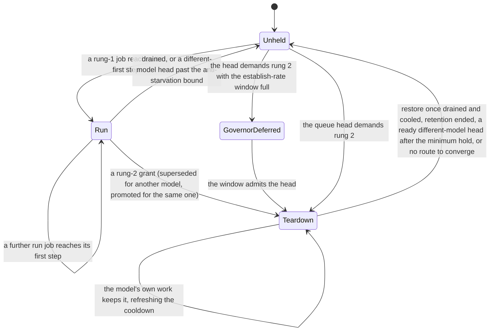

# Runs and residency responsibility map

A model whose sampling peak leaves no room for other work on a card is granted that card in one of two forms.
On rung 1 (`DominanceRung.CANNOT_CO_SAMPLE`) no offered model can sample beside it, and it holds a
dominant-model run. The pop offer narrows to it and its weights stay on the card between its jobs, with nothing
torn down. On rung 2 (`DominanceRung.CANNOT_CO_RESIDE`) its peak beside one sibling context exceeds the card, and
it holds a teardown residency. Idle siblings stop, safety and the service lanes leave the card, and the offer
narrows the same way. Both forms are one entry per card in `WholeCardResidencyLedger`, and every reader of
either goes through that ledger, so ending a grant withdraws everything the grant carried at once. The second
half of this page covers line skips, the seat paths that place a job ahead of the queue head. Only a head
dispatch runs the residency gate, so each seat that can place a dominant model asks the rung itself.

The reasoning behind each rule is in [Resource governance](../explanation/resource_governance.md),
[VRAM arbiter](../explanation/vram_arbiter.md), [Admission pipeline](../explanation/admission_pipeline.md) and
[Resilience and recovery](../explanation/resilience_and_recovery.md).

Module paths are under `horde_worker_regen/process_management/`. `InferenceScheduler` is in
`scheduling/inference_scheduler.py`, "the ledger" is `WholeCardResidencyLedger` in
`scheduling/governance/whole_card.py`, and unqualified method names are `InferenceScheduler` methods.

## A card's grant

`GovernorDeferred` is the ledger's deferral record beside an unheld card, not a grant. The card keeps serving
other work while the record stands.

## The rung verdict

| Decision | Owner | Rule |
| --- | --- | --- |
| Which rung a model is on | `card_dominance`, `pricing.model_dominance`, priced at `pricing.model_sampling_peak` | The verdict is computed per card from the offered set, the whole-card pins, the card total, the context constants, the admission margin, the foreign floor and the learned sampling peaks, and is recomputed only when one of those inputs changes. A model keeps its rung until a test's slack crosses zero by more than `pricing.DOMINANCE_HYSTERESIS_MB`, so a reading near the threshold does not turn runs on and off. A card with no reported total has no verdict. |
| Which models the pop-time large-model limiters act on | `JobPopper._is_large_model` (the EXTRA_LARGE size tier) | The switch throttle, the re-entry cooldown (`jobs/large_model_pop_governor.py`) and the VRAM-pressure narrowing key on the size tier. That is a different predicate from the measured rung, so a model can be large to the popper and on no rung, or on a rung without being large. |

## Dominant-model runs (rung 1)

| Decision | Owner | Rule |
| --- | --- | --- |
| A run starts or extends | `_grant_dominant_runs_at_first_step`, `_dominant_run_grantable`, `_note_dominant_run`; ledger `record_grant` with `CANNOT_CO_SAMPLE` | A run is granted when a job whose model has a rung-1 verdict reports its first step (`INFERENCE_STARTING`) and the card holds no rung-2 grant and no grant for another model. The grant waits for the first step because the run's claim narrows intake, and a claim taken at the dispatch commit would narrow it for the whole load and outlive a load that never lands. |
| What a run does not claim | ledger `record_grant` on rung 1, `teardown_held` | A run does not stop a sibling, open a grace window, count toward the establish-rate limiter or carry a minimum hold. Readers whose premise is a teardown (the residency's convergence and target tightening, `residency_bypass_models`) read `teardown_held()`, which returns rung-2 grants only. |
| A run's copy stays on the card | `pricing.copy_belongs_to_dominant_run`, read by `pricing.sweep_spares_idle_copy`, `preload.lanes_committed_elsewhere`, `_issue_retention_eviction` and the retention governor gate through `_weights_belong_to_dominant_run` | The copy belongs to the run while the ledger holds the model on that card and the run has a next job that can be seated. That is a queued job for the model that no dispatch gate holds without a reclaim able to release it (`pricing._dispatch_held_without_release`, the rule `ready_seat_process_ids` applies to a seat), or, while no job for the model is queued, the standing pop claim. A held run job does not count, because a different-model job cleared beside the run would otherwise wait for room only the spared copy holds while its own booking holds the run's job, until the lease-acquire timeout ends both. A run job awaiting its auxiliary files does count, since no dispatch gate holds it. |
| The reclaim ladder and a run's copy | `resources/reclaim_ladder.py` `build_reclaim_ladder`, from `build_reclaim_ladder_candidates` and `_idle_reclaim_residents` | The ladder's `UNLOAD_IDLE_MODEL` candidates exclude busy slots, slots owning a dispatched job and models a job in progress or the caller protects. They do not ask `copy_belongs_to_dominant_run`, so the ladder can evict a run's copy that the sweep, preload and retention spare. |
| A run job passes a held head | `_select_dominant_run_job` and `_dominant_run_seat_for_cold_head`, line-skip reason `dominant_run` | When the head was withheld this cycle by a residency reconciliation hold (`SlotDutyBucket.RESIDENCY_RECONCILIATION`), or the head is cold and its last preload was declined by the budget (`AdmissionDecision.DEFER_BUDGET`, scoped to the card that preload targeted), a pending job of a rung-1 run on the head's card is seated on the lane holding the run's weights, without spending the head's skip budget. On one card a held head ends the dispatch pass, so a run job queued behind it would keep the run and the head waiting on each other. The seat does not read the head's age, because the run end carries that bound. |
| A run ends | `_restore_siblings_after_whole_card` and `_end_run_superseded_by`, each through `_end_dominant_run`; ledger `record_run_end` | A run ends for one of three causes (`DominantRunEndCause`). `starved_head`: the undispatched head is a different model past `_head_aged_past_anti_starvation`, even with the run's own work queued, since the horde deadline outranks run continuity. `drained`: the run's work has drained and the cooldown has passed, a different-model head waits, or claim retention has ended. `superseded`: a rung-2 grant for a different model is about to replace the card's state. `_end_dominant_run` writes the ledger clear, the log line and the `DOMINANT_RUN_ENDED` action-ledger row together for every cause. The end does not open a restore window or charge the grace budget, since the run stopped nothing. A rung-2 grant for the run's own model promotes the run to a teardown on the same weights, which restarts every establishment clock. |

## Teardown residencies (rung 2)

| Decision | Owner | Rule |
| --- | --- | --- |
| A residency is demanded | `StreamForecast.needs_exclusive_residency` (`resources/resource_budget.py`), ledger `residency_demanded`; asked by `_decide_whole_card_demand` (preload admission) and `_resident_whole_card_head_ready` (dispatch) | Only the head may demand the card, since a deep-queue heavy model would otherwise tear down the siblings serving the head. At preload the head is `preload.preload_head` and at dispatch it is the dispatch head. Both skip aux-unprepared jobs, so the card can be granted for a job behind a queue head that is waiting for its auxiliary files (see "Which head each reader means"). The dispatch path runs only for a job dispatched without a line skip, and a disaggregation-class job never claims the card. |
| An establishment is deferred for churn | ledger `governor_hold` and `establish_rate_exceeded` (`_ESTABLISH_WINDOW_LIMIT`, two per `_ESTABLISH_WINDOW_SECONDS`, 240 s), asked through `_whole_card_governor_defers` | The establish-rate limiter is the only governor that defers an establishment. Two per window lets a retry follow a failed first establishment at once, and a third inside the window is the signature of a pricing oscillation. Preload admission asks when the card holds no grant. The dispatch path asks when the card holds no grant or a grant for another model. A deferred head is never admitted co-resident, since its forecast already says its weights stream beside the siblings. |
| The deferral record | `_whole_card_governor_defers`; ledger `note_governor_defer`, `clear_governor_defer`, `governor_deferred_head` | Both paths record and clear through the one helper, so a head the limiter lets through on either path clears the record, and the "Whole-card governor deferral ... cleared after Ns held" line times the deferral from its own first record. The record counts for at most one establish window from that first record, so a record nobody clears stops excusing the card on its own. |
| What a deferral does to the rest of the worker | `AdmissionDecision.DEFER_RESIDENCY_GOVERNOR`, mapped to `PreloadPassControl.NEXT_JOB` by `preload.pass_control_for`; the `diversity` seat after `_resident_whole_card_head_ready` in `get_next_job_and_process`; `_displaced_head_outstanding_mb`; `whole_card_governor_defer_active`, read by `lifecycle/worker_recovery_coordinator.py`; the `defer_residency_governor` entry in `liveness/gate_registry.py` | The deferral does not park the card. The preload pass goes on to later jobs. At dispatch a head the limiter withholds is stepped past by the `diversity` seat to a different model resident on a free lane (`_select_idle_thread_diversity_job`), and the head is still never dispatched co-resident. Head protection is released for the deferred head, since reserving its whole-card demand against smaller ready work would idle the card for a claim the head is not making. The record excuses the recovery supervisor while it stands. Other preload stops that belong to the head's own escalation still end the pass (`stop_is_card_scoped`, `_HEAD_ESCALATION_STOPS`), since those escalations outrank later loads. |
| Whether an establishment or restore opens a grace window | ledger `grace_seconds_to_open` (`_GRACE_BUDGET_SECONDS`, 360 s per `_GRACE_BUDGET_WINDOW_SECONDS`, 1200 s), charged by `record_grant` and `record_restore`, withdrawn by `close_restore_window`; read through `whole_card_residency_grace_active` | A card with allowance left opens the whole window, and a card that has spent it does not open one. The establishment or restore proceeds in both cases, because a card held off for want of an excuse sits idle with the head unserved. The cap keeps back-to-back churn from re-arming the supervisor's excuse faster than it expires. A restore that regrows nothing and restarts no lane withdraws its window and its charge, so the supervisor is not told to ignore a wedge for a teardown that did not happen. |
| The minimum hold | `whole_card._MIN_HOLD_SECONDS` (90 s), `min_hold_disclosure` | Inside the hold a ready different-model head may not cut a fresh teardown short, since a release seconds after the grant buys one lighter job for two pool rebuilds. The hold is shorter than the establish grace (`WHOLE_CARD_ESTABLISH_GRACE_SECONDS`, 120 s), so it never keeps a residency alive past the supervisor's window. A run carries no minimum hold. |
| A residency ends | `_restore_siblings_after_whole_card`; setting `whole_card_residency_cooldown_seconds` | A residency is kept while its model has work pending or in progress, and each such cycle refreshes its cooldown. Once drained it is held through the cooldown unless claim retention has ended or a ready different-model head arrives after the minimum hold. The release opens the restore window, restarts the post-processing, VAE and component lanes it paused, and regrows the pool to `_residency_restore_ceiling`, which a RAM shed holds at the current count. |
| A residency that cannot converge | `_residency_can_never_converge`; `JobTracker.release_pending_exclusive_admits` | Past the establish grace, a residency whose model has no holder, nothing loading or pre-staging it, no exclusive job running and a different-model undispatched head is released through the normal restore path. The release clears the `admitted_exclusive` mark of pending jobs for that model on that card. Their claim was for the released residency, and left in place it would decline every other head's preload as `EXCLUSIVE_IN_PROGRESS` with nothing on the card to protect. Jobs in progress keep the mark. |

## The pop claim (both rungs)

| Decision | Owner | Rule |
| --- | --- | --- |
| The offer narrows to the held model | ledger `pop_claim`, through `whole_card_pop_claim`; applied last in `JobPopper` by `_apply_whole_card_pop_claim` and `whole_card.offer_under_pop_claim` | Every held grant of either rung claims the offer. The claim is applied after every other offer stage, so an earlier stage (the VRAM-pressure narrowing among them) can remove the claimed model, and the claim then withholds the pop under `PopGate.WHOLE_CARD_POP_CLAIM`. The claim is skipped while more than one card serves work, since holding the whole worker's intake to one card's model would starve the others. |
| How long the claim and retention last | setting `whole_card_residency_max_hold_seconds` (`bridge_data/data_model.py`), read through `_whole_card_max_hold_seconds`; ledger `pop_claim_retention_ended`, `note_pop_outcome`, `note_terminal_fault` | The claim ends at the maximum hold counted from the establishment, after three empty pops spanning at least 10 s (`_POP_CLAIM_EMPTY_POP_RUN`, `_POP_CLAIM_EMPTY_POP_WINDOW_SECONDS`), or on a terminal fault of the claimed model. Its end ends retention only, so work already accepted drains. A maximum hold of zero disables the claim and the cap together. |
| Large-model re-entry cooldown opens | `is_whole_card_residency_active` (ledger `any_held`), read by `jobs/large_model_pop_governor.py` | The cooldown starts when no card holds a grant of either rung, so it opens between runs as it does between teardowns. |
| A model's return to the card is paced | the claim cap, `governor_hold`, the large-model re-entry cooldown | Each paces the return on its own clock, and none reads the others or the demand behind them. A burst that outlasts the cap re-establishes, and each re-established teardown spends a place in the limiter's window. |

## Line skips past the head

| Decision | Owner | Rule |
| --- | --- | --- |
| Which seat paths may pass the head | `LineSkip.reason` (`jobs/job_models.py`); the seats in `get_next_job_and_process`: the resident-bypass loop (`resident_bypass`), `_select_dominant_run_job` (`dominant_run`), `_select_idle_thread_diversity_job` (`diversity`), `_select_job_behind_post_processing_hold` (`post_processing_hold`), `_select_cross_card_job` (`cross_card`) | Only `resident_bypass` spends the head's skip budget. A line-skipped job does not pass through `_resident_whole_card_head_ready` or the concurrent-overlap headway check that a head dispatch runs. |
| Whether a line skip may seat a dominant model | `_line_skip_seat_barred_by_rung`, asked by the diversity seat and the resident bypass | A rung-2 model is seated only on a card where it already holds the teardown residency, because only the head path performs the teardown. The diversity seat also bars a rung-2 model while its card has a job in progress. A rung-1 model is barred by the diversity seat while its card has a job in progress, since it cannot sample beside any other model, and may be seated on an idle card, where it can start its run. The resident bypass does not apply the in-progress test. A card with no verdict bars nothing. The `dominant_run`, `post_processing_hold` and `cross_card` seats do not ask the rung. |
| How far a resident-model job may pass a cold head | `scheduling/dispatch_affinity.py` (`affinity_skip_allowed`: `_AFFINITY_MAX_SKIPS`, six, and `_AFFINITY_BUDGET_FRACTION`, 0.2 x ttl from the first skip) | A bypass past either bound is refused, and a placement reorder that seats a job ahead of the head spends the same budget. An unbounded bypass could starve the head behind a steady stream of resident work. |
| When a head's age overrides a hold | `dispatch_affinity.ANTI_STARVATION_TTL_FRACTION` (0.3 x ttl from pop), through `_head_aged_past_anti_starvation` | Past the bound the affinity budget is withdrawn, the placement reorder stops, and a rung-1 run holding the card for another model ends. The skip budget alone does not bound the head's age since pop, which is what this second clock adds. A head with neither a ttl nor a pop time keeps the skip budget alone. |
| Teardown-resident jobs pass a cold head | `residency_bypass_models` in `get_next_job_and_process`, built from ledger `teardown_held()` | Queued jobs of a model holding a teardown residency pass a cold head without spending its budget, since a teardown bars the head from loading until it drains and only that model's own jobs drain it. The set does not read the deadline clocks, so these jobs can pass a head past its anti-starvation bound. Run jobs are not in the set. Past the skip budget they reach the card through the `dominant_run` seat, which is offered for a cold head only when the budget declined its preload, since the room that preload needs can be held by the run's spared copy. The pop claim still limits candidates to the claimed model. |
| Other holds on a head | `HEAD_PROTECTION_MAX_STARVE_SECONDS` (120 s) and `HEAD_RAM_DEFER_BARRIER_SECONDS` (60 s) in `scheduling/ledgers/head_admission.py`; `CLEARANCE_LEASE_ACQUIRE_TIMEOUT_SECONDS` (60 s, `scheduling/clearance_lease.py`); `POP_LIVENESS_FROZEN_QUEUE_SECONDS` (120 s, `process_manager.py`); the establish window; the claim cap | Each runs a fixed clock that does not read the horde deadline. |

## Which head each reader means

The worker computes "the head" in several places, over two orders and three skip sets. Pop order is
`JobTracker.jobs_pending_inference`, which keeps a job until its result or fault arrives and so includes jobs in
progress. Placement order is `pending_inference_in_placement_order`: pop order with the jobs a retained copy or a
held residency's copy can serve moved ahead of the head, read only by the preload pass and dispatch.

| Head | Order | Skips | Decisions it drives |
| --- | --- | --- | --- |
| `JobTracker.undispatched_head` | pop | in progress | the never-converge release; both rung-1 run ends; the structural-wedge excuse (`dispatch_hold_liveness_active`, `dispatch_hold_liveness_seconds`); a ready different-model head cutting a rung-2 cooldown (`_ready_different_model_head_on_device`); the SOS give-up deferral (`head_model_materializing`); the dispatch-stall line; slot duty; the post-processing drain hold; `head_of_queue_is_parked`, which the lane and context restores in `process_manager.py` read |
| `preload.preload_head` | placement | in progress, aux-unprepared | the preload pass's `is_head_blocker`, which gates the head-room fallback, head-priority pricing and reclaim, and the rung-2 demand at preload; the starvation clock (`_update_head_starvation_timer`); the head-priority barrier |
| The dispatch head in `get_next_job_and_process` | placement | in progress, quarantined, aux-unprepared | every dispatch gate; the head a line skip displaces and its affinity window; `_resident_whole_card_head_ready`; head protection (`_displaced_head_outstanding_mb`) |
| The placement anchor (`pending_inference_in_placement_order`, `_reordered_head_displaced_by`, `_residency_promoted_lanes`) | pop | in progress, aux-unprepared | which jobs the reorder promotes and whose skip budget a reorder spends |
| The queue's first job (`preload.slots_holding_the_head_model`, `preload.models_spared_from_displacement`, `pricing.coresident_lookahead_affordable`) | pop | nothing | which warm slots a preload may not take, which models a follower may not displace, and whether a lookahead copy can share the card with the head's sampling |
| The sweep's head (`pricing.sweep_spares_idle_copy`) | pop | in progress | the one ready seat a head-escalation sweep spares. An aux-held head claims no seat (`ready_seat_process_ids`), so that sweep spares none for it. |
| `HordeWorkerProcessManager._head_aux_prefetch_in_flight`, `_pending_head_job` | pop | in progress | the SOS give-up deferral for a head whose auxiliary prefetch is in flight; pop liveness |
| The queue-deadlock terms in `ipc/message_dispatcher.py` | pop | aux-held with a live prefetch deadline, disaggregation-held | the structural-wedge latch |
| `HeadAdmissionLedger.starved_seconds` | times the `preload_head` job | as `preload_head` | returns zero for any other job, so a reader that passes `undispatched_head` (the stall line, `head_of_queue_is_parked`) reads zero whenever the two heads differ |

Two consequences follow for residencies. A rung-2 grant can be made for the job behind an aux-held queue head,
while `_residency_can_never_converge` judges the residency against `undispatched_head`, which names the aux-held
job. A grant is not revisited when the head it was made for stops being the head, so the never-converge release,
past the establish grace and with no holder, is the bound on a grant whose job cannot reach the card.

## Limits of what can be read from a log

- The pop gate is recorded as state (`WorkerState.last_pop_gate`) and is not written to the parent log, so
  whether the VRAM-pressure narrowing emptied a claim's offer cannot be read from a bundle.
- A drained run's end is logged at DEBUG, and a run's start only on its establishment. The `DOMINANT_RUN_ENDED`
  action-ledger row is the complete record of run ends.

## Where to read next

- [Resource governance](../explanation/resource_governance.md): whole-card residency state, bounding residency
  churn and the residency claims intake.
- [VRAM arbiter](../explanation/vram_arbiter.md): the four layers (rungs and runs) and cross-job retention.
- [Admission pipeline](../explanation/admission_pipeline.md): dispatch selection and continuing the preload pass.
- [Resilience and recovery](../explanation/resilience_and_recovery.md): the SOS layer and what counts as progress.
- [Log findings](log_findings.md): `whole_card_residency_churn`, `whole_card_pop_claim_episodes`,
  `whole_card_pop_claim_monopoly`, `whole_card_nonhead_residency_starvation`, `whole_card_convergence_wedge`,
  `head_dispatch_stall` and `slow_generation_drop_spiral`.
- [Clearance and child loads responsibility map](responsibility-map-clearance-and-child-loads.md): what admits and
  clears a job once it holds the card.
