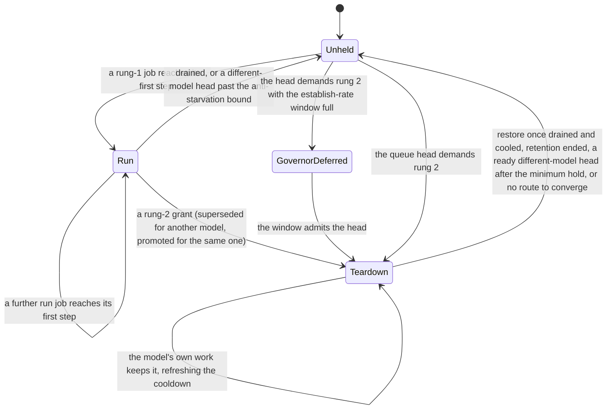

# Runs and residency responsibility map

A model whose sampling peak leaves no room for other work on a card is granted that card in one of two forms.
On rung 1 (`DominanceRung.CANNOT_CO_SAMPLE`) no offered model can sample beside it, and it holds a
dominant-model run. The pop offer narrows to it and its weights stay on the card between its jobs, with nothing
torn down. On rung 2 (`DominanceRung.CANNOT_CO_RESIDE`) its peak beside one sibling context exceeds the card, and
it holds a teardown residency. Idle siblings stop, safety and the service lanes leave the card, and the offer
narrows the same way. Both forms are one entry per card in `WholeCardResidencyLedger`, and every reader of
either goes through that ledger, so ending a grant withdraws everything the grant carried at once. The second
half of this page covers line skips, the seat paths that place a job ahead of the queue head. Only a head
dispatch runs the residency gate, so each seat that can place a dominant model asks the rung itself.

The reasoning behind each rule is in [Resource governance](../explanation/resource_governance.md),
[VRAM arbiter](../explanation/vram_arbiter.md), [Admission pipeline](../explanation/admission_pipeline.md) and
[Resilience and recovery](../explanation/resilience_and_recovery.md).

Module paths are under `horde_worker_regen/process_management/`. `InferenceScheduler` is in
`scheduling/inference_scheduler.py`, "the ledger" is `WholeCardResidencyLedger` in
`scheduling/governance/whole_card.py`, and unqualified method names are `InferenceScheduler` methods.

## A card's grant

`GovernorDeferred` is the ledger's deferral record beside an unheld card, not a grant. The card keeps serving
other work while the record stands.

## The rung verdict

| Decision | Owner | Rule |
| --- | --- | --- |
| Which rung a model is on | `card_dominance`, `pricing.model_dominance`, priced at `pricing.model_sampling_peak` | The verdict is computed per card from the offered set, the whole-card pins, the card total, the context constants (the first-context and marginal figures that the startup accelerator probe measures and `scheduling/context_overhead_model.py` holds, of which only the marginal can be revised later, from an idle-residency observation), the admission margin, the foreign floor and the learned sampling peaks, and is recomputed only when one of those inputs changes. A model keeps its rung until a test's slack crosses zero by more than `pricing.DOMINANCE_HYSTERESIS_MB`, so a reading near the threshold does not turn runs on and off. A card without a reported total does not have a verdict. |
| Which models the pop-time large-model limiters act on | `JobPopper._is_large_model` (the EXTRA_LARGE size tier) | The switch throttle, the re-entry cooldown (`jobs/large_model_pop_governor.py`) and the VRAM-pressure narrowing key on the size tier. That is a different predicate from the measured rung, so a model can be large to the popper and on no rung, or on a rung without being large. |

## Dominant-model runs (rung 1)

| Decision | Owner | Rule |
| --- | --- | --- |
| A run starts or extends | `_grant_dominant_runs_at_first_step`, `_dominant_run_grantable`, `_note_dominant_run`; ledger `record_grant` with `CANNOT_CO_SAMPLE` | A run is granted when a job whose model has a rung-1 verdict reports its first step (`INFERENCE_STARTING`) and the card holds no rung-2 grant and no grant for another model. The grant waits for the first step because the run's claim narrows intake, and a claim taken at the dispatch commit would narrow it for the whole load and outlive a load that never lands. |
| What a run does not claim | ledger `record_grant` on rung 1, `teardown_held` | A run does not stop a sibling, open a grace window, count toward the establish-rate limiter or have a minimum hold. Readers whose premise is a teardown (the residency's convergence and target tightening, `residency_bypass_models`) read `teardown_held()`, which returns rung-2 grants only. |
| A run's copy stays on the card | `pricing.copy_belongs_to_dominant_run`, read by `pricing.sweep_spares_idle_copy`, `preload.lanes_committed_elsewhere`, `_issue_retention_eviction` and the retention governor gate through `_weights_belong_to_dominant_run` | The copy belongs to the run while the ledger holds the model on that card and the run has a next job that can be seated. That is a queued job for the model that no dispatch gate holds without a reclaim able to release it (`pricing._dispatch_held_without_release`, the rule `ready_seat_process_ids` applies to a seat), or, while no job for the model is queued, the standing pop claim. A held run job does not count, because a different-model job cleared beside the run would otherwise wait for room only the spared copy holds while its own booking holds the run's job, until the lease-acquire timeout ends both. A run job awaiting its auxiliary files does count, since no dispatch gate holds it. The head's admission room does not permit a rung on the spared copy and `has_reclaimable_idle_tenancy` does not count it (`pricing.idle_copies_spared_by_sweep`, `VramRequest.spared_idle_process_ids`), and the copy keeps the card from reading converged-empty. |
| The reclaim ladder and a run's copy | `resources/reclaim_ladder.py` `build_reclaim_ladder`, from `build_reclaim_ladder_candidates` and `_idle_reclaim_residents` | The ladder's `UNLOAD_IDLE_MODEL` candidates exclude busy slots, slots owning a dispatched job and models a job in progress or the caller protects. They do not ask `copy_belongs_to_dominant_run`, so the ladder can evict a run's copy that the sweep, preload and retention spare. |
| A run job passes a held head | `_select_dominant_run_job` and `_dominant_run_seat_for_cold_head`, line-skip reason `dominant_run` | When the head was withheld this cycle by a residency reconciliation hold (`SlotDutyBucket.RESIDENCY_RECONCILIATION`), or the head is cold and the latest preload pass declined its preload on the budget (`AdmissionDecision.DEFER_BUDGET` in the head's entry, `HeadAdmissionLedger.preload_admission_for`, scoped to the card that preload targeted), a pending job of a rung-1 run on the head's card is seated on the lane holding the run's weights, without spending the head's skip budget. On one card a held head ends the dispatch pass, so a run job queued behind it would keep the run and the head waiting on each other. The seat does not read the head's age, because the run end carries that bound. |
| A run ends | `_restore_siblings_after_whole_card` and `_end_run_superseded_by`, each through `_end_dominant_run`; ledger `record_run_end` | A run ends for one of three causes (`DominantRunEndCause`). `starved_head`: the undispatched head is a different model past `_head_aged_past_anti_starvation`, even with the run's own work queued, since the horde deadline outranks run continuity. The head is the worker-wide `JobTracker.undispatched_head`, so on a multi-card host a head that only another card can seat still ends a run on this card. `drained`: the run's work has drained and the cooldown has passed, a different-model head waits, or claim retention has ended. `superseded`: a rung-2 grant for a different model is about to replace the card's state. `_end_dominant_run` writes the ledger clear, the log line and the `DOMINANT_RUN_ENDED` action-ledger row together for every cause. The end does not open a restore window or charge the grace budget, since the run stopped nothing. A rung-2 grant for the run's own model promotes the run to a teardown on the same weights, which restarts every establishment clock. |

## Teardown residencies (rung 2)

| Decision | Owner | Rule |
| --- | --- | --- |
| A residency is demanded | `StreamForecast.needs_exclusive_residency` (`resources/resource_budget.py`), ledger `residency_demanded`; asked by `_decide_whole_card_demand` (preload admission) and `_resident_whole_card_head_ready` (dispatch) | Only the head may demand the card, since a deep-queue heavy model would otherwise tear down the siblings serving the head. At preload the head is `preload.preload_head` and at dispatch it is the dispatch head. Both skip aux-unprepared jobs, so the card can be granted for a job behind a queue head that is waiting for auxiliary files (see "Which head each reader means"). When those files land before the granted job is preloaded, the earlier jobs are refused with `EXCLUSIVE_IN_PROGRESS`. That refusal does not end the preload pass, on one card or several. The pass goes on over the held card for the job whose exclusive admit was planned for that card (`preload.is_exclusive_beneficiary`) and skips every other job aimed there. The dispatch path runs only for a job dispatched without a line skip, and a disaggregation-class job never claims the card. The preload demand does not choose a card. It acts on the card of the slot `select_preload_target` chose (`_routing_device_index`). On a multi-GPU host that choice skips a card whose ceiling cannot seat the job when another eligible card can seat it once free (`preload.slots_unable_to_seat`), so the demand does not reserve a card for a model the card cannot run. |
| An establishment is deferred for churn | ledger `governor_hold` and `establish_rate_exceeded` (`_ESTABLISH_WINDOW_LIMIT`, two per `_ESTABLISH_WINDOW_SECONDS`, 240 s), asked through `_whole_card_governor_defers` | The establish-rate limiter is the only governor that defers an establishment. Two per window lets a retry follow a failed first establishment at once, and a third inside the window is the signature of a pricing oscillation. Preload admission asks when the card holds no grant. The dispatch path asks when the card holds no grant or a grant for another model. A deferred head is never admitted co-resident, since its forecast already says its weights stream beside the siblings. |
| The deferral record | `_whole_card_governor_defers`; ledger `note_governor_defer`, `clear_governor_defer`, `governor_deferred_head` | Both paths record and clear through the one helper, so a head the limiter lets through on either path clears the record, and the "Whole-card governor deferral ... cleared after Ns held" line times the deferral from its own first record. The record counts for at most one establish window from that first record, so a record nobody clears stops excusing the card on its own. |
| What a deferral does to the rest of the worker | `AdmissionDecision.DEFER_RESIDENCY_GOVERNOR`, mapped to `PreloadPassControl.NEXT_JOB` by `preload.pass_control_for`; the `diversity` seat after `_resident_whole_card_head_ready` in `get_next_job_and_process`; `_displaced_head_outstanding_mb`; `whole_card_governor_defer_active`, read by `lifecycle/worker_recovery_coordinator.py`; the `defer_residency_governor` entry in `liveness/gate_registry.py` | The deferral does not park the card. The preload pass goes on to later jobs. At dispatch a head the limiter withholds is stepped past by the `diversity` seat to a different model resident on a free lane (`_select_idle_thread_diversity_job`), and the head is still never dispatched co-resident. Head protection is released for the deferred head, since reserving its whole-card demand against smaller ready work would idle the card for a claim the head is not making. The record excuses the recovery supervisor while it stands. Other preload stops that belong to the head's own escalation still end the pass (`stop_is_card_scoped`, `_HEAD_ESCALATION_STOPS`), since those escalations outrank later loads. |
| Whether an establishment or restore opens a grace window | ledger `grace_seconds_to_open` (`_GRACE_BUDGET_SECONDS`, 360 s per `_GRACE_BUDGET_WINDOW_SECONDS`, 1200 s), charged by `record_grant` and `record_restore`, withdrawn by `close_restore_window`; read through `whole_card_residency_grace_active` | A card with allowance left opens the whole window, and a card that has spent it does not open one. The establishment or restore proceeds in both cases, because a card held off for want of an excuse sits idle with the head unserved. The cap keeps back-to-back churn from re-arming the supervisor's excuse faster than it expires. A restore that regrows nothing and restarts no lane withdraws its window and its charge, so the supervisor is not told to ignore a wedge for a teardown that did not happen. |
| The minimum hold | `whole_card._MIN_HOLD_SECONDS` (90 s), `min_hold_disclosure` | Inside the hold a ready different-model head may not cut a fresh teardown short, since a release seconds after the grant buys one lighter job for two pool rebuilds. The hold is shorter than the establish grace (`WHOLE_CARD_ESTABLISH_GRACE_SECONDS`, 120 s), so it never keeps a residency alive past the supervisor's window. A run carries no minimum hold. |
| A residency ends | `_restore_siblings_after_whole_card`; setting `whole_card_residency_cooldown_seconds` | A residency is kept while the model has work pending or in progress, and each such cycle refreshes the cooldown. Once drained it is held through the cooldown unless claim retention has ended or a ready different-model head arrives after the minimum hold. A residency that cannot converge (the next three rows) is released without waiting for the cooldown or the minimum hold. The release opens the restore window, restarts the post-processing, VAE and component lanes paused by the residency, and regrows the pool to `_residency_restore_ceiling`, which a RAM shed holds at the current count. |
| A residency that cannot converge | `_residency_can_never_converge`; `JobTracker.release_pending_exclusive_admits` | Past the establish grace, a residency is released through the normal restore path when the model is not held, loading or pre-staged on any lane, an exclusive job is not running, and the undispatched head is a different model. The release does not wait for the cooldown, which each pass refreshed while the model was pending, or for the minimum hold. The release clears the `admitted_exclusive` mark of pending jobs for that model on that card. Their claim was for the released residency, and left in place it would decline every other head's preload as `EXCLUSIVE_IN_PROGRESS` while the card does not hold anything to protect. Jobs in progress keep the mark. |
| A residency whose model is placed on another card | `_residency_model_placed_on_another_card`, read by `_restore_siblings_after_whole_card` apart from the serving test | Past the establish grace, a residency with no holder and no loading pre-stage on its own card, while its model is loading or resident on another card, is released through the normal restore path and clears the pending exclusive admits as above. The model's pending jobs dispatch to the copy on the other card and keep the serving test true, so this check runs separately from that test. |
| A residency whose head cannot be seated on its card | `_note_dispatch_hold`, ledger `note_head_unseatable` and `head_unseatable`, read by `_restore_siblings_after_whole_card`; `_dispatch_hold_has_no_remedy`, read by `_decide_whole_card_demand` and `_resident_whole_card_head_ready` | A dispatch hold with `HoldRemedy.NONE` or `HoldRemedy.REROUTE` on the job that a residency was granted for (its `admitted_exclusive` mark names the residency's card) marks the residency. The next release pass restores it through the normal path inside the establish grace and the cooldown, and clears the pending exclusive admits as above. The restore clears the grant, which ends the establish grace. A head whose latest hold has no remedy is not granted a new residency by either demand path. |
| A pending exclusive admit without a residency | `_release_exclusive_admits_without_residency`, called by `_restore_siblings_after_whole_card`; `JobTracker.release_pending_exclusive_admits` | Each release pass clears the mark of a pending job when the admit's card does not hold a residency for the job's model. A residency can end without clearing the mark, and a soft reset rebuilds the lanes without touching the marks or the ledger. While the mark stands, every other preload onto the card is refused as `EXCLUSIVE_IN_PROGRESS`. An admit without a card is kept while any card holds a residency for the model. An over-budget admit keeps the mark, since that mark isolates the job for the job's whole life. The job is marked again when a demand path grants it a residency. |
| The exclusive mark is set | `JobTracker.mark_admitted_exclusive`, called by `_decide_whole_card_demand`, `_resident_whole_card_head_ready`, `_mark_overbudget_admit` and `_transfer_exclusive_claim_to_head` | A demand path marks the job it grants the card for, with the card in `admitted_exclusive_device_index`. That job can sit behind a queue head waiting for auxiliary files, as the "A residency is demanded" row states. An over-budget admit is marked when `overbudget_exclusive_mode` is on and its forecast requires isolation, and it also carries `admitted_over_budget`. The dispatch head takes a pending claim as the "A same-model head behind a pending admit" row states. Marking an already marked job only updates its card. |
| The exclusive mark is cleared | `JobTracker.release_pending_exclusive_admits`, called by the three release rows above, `_release_exclusive_admits_without_residency` and `_transfer_exclusive_claim_to_head`; the job's end | A release clears the marks of pending jobs for one model on one card. Jobs in progress keep the mark, and a mark ends with the job at completion or a terminal fault. `_release_exclusive_admits_without_residency` does not release a mark while its card holds a residency for the job's model, so while that residency stands only a release row above, a claim transfer or the job's end clears it. |
| Dispatch while a pending admit's residency is held | `_exclusive_dispatch_suppression_active`, read by `get_next_job_and_process`, `_classify_dispatch_stall` and `_seatable_resident_process` (multi-GPU only) | An unmarked job is withheld from a card while an exclusive job samples in the card's scope, or while a marked job is pending in that scope and a residency is held or being established there. A marked job is not withheld. A mark alone, with no residency and no exclusive job sampling, does not withhold dispatch. An unattributed admit counts on every card. |
| A same-model head behind a pending admit | `_head_takes_exclusive_claim`, read by `get_next_job_and_process` before the suppression check and by `_classify_dispatch_stall`; `_transfer_exclusive_claim_to_head` | When the files of a queue head waiting for auxiliary files land after the card was granted to a job of the same model behind it, the head is the dispatch head again and is unmarked. The dispatch walk does not reach past an idle resident head to a job of the same model, so without the transfer neither job runs while the residency stands. The head takes the claim when it was not reached through a line skip, an exclusive job is not sampling in scope, the card holds a residency for the head's model, and every pending claim in scope is for that model, on that card, and not over budget. The pending marks are released and the head is marked, so one job holds the claim. The job behind is marked again when it next claims the card. A head of another model stays withheld, and an over-budget admit keeps its claim. The stall classifier does not report a hold that this transfer lifts. |
| Which residency holds a head | `_prestaged_whole_card_not_ready`, ledger `holds_model_on_card` | A head waits for the residency on the card of the process it would sample on, until that card reaches sole residency. A residency for the same model on another card does not hold it, because that card's teardown does not make room on the head's card. The stall classifier, the placement anchor (`_residency_promoted_lanes`), `_residency_reorder_resident`, the run seat (`_select_dominant_run_job`) and the retention verdict check the residency on their process's card the same way. Only `note_terminal_fault` looks the residency up by model, because the fault report carries only the model and the pop claim narrows the offer for the whole worker. |

## Pop intake

A pop cycle in `JobPopper.api_job_pop` first passes the gates below, which read worker state and the local
queue. It then builds the offer through the narrowing stages in the second table, in order, and sends the
request only when the offer is not empty. Every cycle that ends early stamps its gate on
`WorkerState.last_pop_gate` (`PopGate`), and each gate's release path is declared in `liveness/gate_registry.py`.
`JobPopper` is in `jobs/job_popper.py`, and `_select_models_for_pop` in the same module runs stages 1 to 5.

| Decision | Owner | Rule |
| --- | --- | --- |
| The order of the gates before the offer | `JobPopper.api_job_pop` | Intake paused, the soft RAM hold, an unusable torch build or accelerator, image generation not served, the consecutive-failure pause, queue full, the post-inference backlog (safety or submit), warm-up, no serving safety process, no available inference process, no configured models, the megapixelstep wait and the pop-frequency gate, in that order. The first that holds ends the cycle. An idle-fill pop skips the megapixelstep wait, and an urgent pop skips the frequency gate. |
| Which gates read the local queue, and what each counts | `JobPopper._is_queue_full` (`_intake_budget`), `_is_post_inference_backlogged`, the warm-up test in `api_job_pop`, `PopThrottler.should_wait_for_megapixelsteps` (`JobTracker.get_pending_megapixelsteps`), the per-model cap in `_select_models_for_pop`, `_lora_queue_cap_reached`, `_large_models_loaded_or_queued`, `_apply_vram_pressure_model_narrowing` | Queue full counts `jobs_pending_inference`, which holds every job from pop until its result or fault, so jobs in progress and jobs waiting for auxiliary files count in full. The megapixelstep sum covers the same list plus a charge per job awaiting submit. The per-model cap counts each model's jobs in that list (3 for a model loaded on a lane, 2 otherwise), and the LoRA share cap counts its LoRA jobs. The backlog gate counts jobs in safety and jobs awaiting submit. Warm-up holds while any job is pending and none has completed. The large-model limiters treat a queued very-large model as in play, and the VRAM-pressure narrowing applies only while `num_jobs_total` is above zero, which also counts jobs in safety and submit. The gates do not check whether a queued job could dispatch now. |
| Intake while every inference process is busy | `JobPopper.api_job_pop`, `ProcessMap.get_first_available_inference_process` | The pop is withheld under `PopGate.NO_INFERENCE_PROCESS` unless some inference process can accept a job, meaning it is idle or holds a preload and is without a dispatched job. While every lane holds a job the worker does not pop, so `queue_size` does not provide a standby job behind a running one. A card with one inference context therefore does not hold a standby job and does not have a spare context to preload the next model. Each job there waits for a horde round trip after the previous one frees the lane, and each model switch loads with the card idle. |
| Which stages can empty a claimed offer | each stage in the table below; the claim's own stage, `_apply_whole_card_pop_claim` | The claim applies last, so any earlier stage that removes the claimed model leaves the claim without a model to offer. The stages that can are the stickiness roll, the per-model queue cap, the locally-unservable hold-back, the serviceability hold-back, quarantine, the VRAM-pressure narrowing, the pool's fixed or free lane, the residency advertising bias (while the claimed model is neither resident nor staged) and the constrained-lane pop (when the claimed model is not the constrained one). The worker does not arbitrate between those stages and the claim. |
| What a withheld pop records | `_note_whole_card_pop_outcome`, `_report_pool_pop_outcome` | The claim's empty-pop run and the pool's lane memory are not updated for a cycle that ended at a gate, since only a request that got a response is evidence of demand. A claim whose offer is emptied every cycle therefore withholds every pop until the claim's cap, a terminal fault or the residency's release, and the empty-pop release does not shorten it. |
| The pool's share of the offer | `ModelPool` (seats, filled by `_maybe_tick_model_pool` in `process_manager.py`), `jobs/pool_lanes.decide_pool_lane` through `JobPopper._apply_pool_lane`; `_report_pool_pop_outcome` to `ModelPool.on_pop_outcome` | The engine seats models. The lane decision takes the offer as the earlier stages left it and returns the seated part (fixed lane) or the rest (free lane). The lane stage runs only when the pool is enabled and holds a seat, and not on an idle-fill pop. An enabled pool also turns the stickiness roll off. A fixed-lane pop that comes back empty charges every seated model it advertised, and a match on either lane credits the matched seat. See [The fixed model pool](../explanation/model_pool.md). |
| Whether a claim pays | `whole_card.pop_claim_value_verdict` over `CardEarningAccumulator.rate`, read by `InferenceScheduler._pop_claim_value` | The verdict is unmeasured below `POP_CLAIM_VALUE_MIN_JOBS` (20) jobs of the claimed model on its card, or while a rate or its standard error has no reading, which needs two time buckets. Each rate has a 95% band whose width in standard errors comes from the number of buckets behind it (`two_sided_95_band_width`, Student's t). The band is computed in `rate_95_band`, which the supervisor snapshot's earning rows also read. It is below the rest when the top of the model's band is under the bottom of the rest's band, and pays otherwise. The ledger keys a single-card host by `None` and the earning store by the lane's device index, so `_pop_claim_value` reads a `None`-keyed claim under the one card runtime's index. The verdict is disclosed on the engage line, on the residency status and on each stats sample. The claim, the offer, dispatch and retention do not read it, so a claim that earns below the rest still narrows the offer for every held grant. The ranker's earning-rate estimate belongs to the pool and is not read by the claim. |

| # | Stage | Owner | Rule |
| --- | --- | --- | --- |
| 0 | Card scope | `_advertised_capabilities`, `_targeted_under_fed_card`, `_next_card_scoped_pop` | On a multi-card host the cycle may scope the offer to one card (queue imbalance or heterogeneous rotation). The scope sets the configured set the stages start from. |
| 1 | On-disk filter | `ModelAvailability.filter_present` | Drops models that are not on disk. A no-op while availability is unknown. |
| 2 | Stickiness roll | `_select_models_for_pop` | Only with the pool disabled, more configured models than processes, and every process holding a model. On a winning roll the offer narrows to the models loaded on idle lanes. |
| 3 | Per-model queue cap | `_select_models_for_pop` (`_RESIDENT_MODEL_POP_QUEUE_CAP`, `_MODEL_POP_QUEUE_CAP`) | Drops a model with 3 jobs pending (loaded on a lane) or 2 (otherwise). |
| 4 | Locally-unservable hold-back | `is_model_locally_unservable_for` | Drops a model whose over-budget faults reached `unservable_model_fault_threshold`, on every card that serves it. |
| 5 | Serviceability hold-back | `_serviceability_held_back_models` | Drops a model whose smallest job fits no card in scope. An empty set after stages 1 to 5 ends the cycle under `NO_ELIGIBLE_MODELS`. |
| 6 | Quarantine | `_apply_quarantine_model_exclusion` | Drops quarantined models. Floored, so it does not empty the offer. |
| 7 | Large-model limiters | `_apply_large_model_pop_limits`, `LargeModelPopGovernor` | The switch throttle and the re-entry cooldown. An empty result ends the cycle under `LARGE_MODEL_LIMITS`. |
| 8 | VRAM-pressure narrowing | `_apply_vram_pressure_model_narrowing` | Drops very-large models while every governed card is under pressure and the worker holds work. Floored. |
| 9 | Pool lane | `_apply_pool_lane` | Replaces the offer with the fixed or free lane. A lane falls back to the other only when its own part is empty. |
| 10 | Residency advertising bias | `_apply_residency_advertising_bias`, `decide_residency_advertising` | Narrows toward resident and staged models while a swap backlog persists, duty-cycled. Skipped on the fixed lane and on idle fill. Floored. |
| 11 | Constrained-lane shaping | `_shape_offer_for_serviceability` (`model_serviceability._CONSTRAINED_LANE_FULL_CYCLES`) | While the offer holds a model that fits only at a reduced size, one pop in four offers only such models, with `max_power` lowered, and the other pops offer only the rest. A constrained claimed model forces the reduced-size pop on every cycle. Does not empty the offer. |
| 12 | Idle-fill ladder | `_apply_idle_fill_ladder` | On an idle-fill pop only, offers a small-models-first slice without LoRA. Off while a claim stands. |
| 13 | Whole-card pop claim | `_apply_whole_card_pop_claim`, `whole_card.offer_under_pop_claim` | Narrows to the claimed model, unfloored. An empty result ends the cycle under `WHOLE_CARD_POP_CLAIM`. |
| 14 | Empty-offer backstop | `api_job_pop` | An empty offer is not sent. The cycle ends under `EMPTY_OFFER` with a warning on the first such cycle. |

## The pop claim (both rungs)

| Decision | Owner | Rule |
| --- | --- | --- |
| The offer narrows to the held model | ledger `pop_claim`, through `whole_card_pop_claim`; applied last in `JobPopper` by `_apply_whole_card_pop_claim` and `whole_card.offer_under_pop_claim` | Every held grant of either rung claims the offer. The claim is applied after every other offer stage, so an earlier stage can remove the claimed model (the stages are listed under "Pop intake"), and the claim then withholds the pop under `PopGate.WHOLE_CARD_POP_CLAIM`. The claim is skipped on any host with more than one card runtime (`_multi_gpu_routing_active`), whatever each card serves, since holding the whole worker's intake to one card's model would starve the others. |
| Who else reads the claim | the resident-bypass loop in `get_next_job_and_process`; `pricing.copy_belongs_to_dominant_run` through `AdmissionSnapshot.pop_claim_model` | While a claim stands only the claimed model's jobs may take the resident bypass past a cold head, and while no job for a run's model is queued the standing claim alone keeps the run's copy spared. A change to the claim therefore changes dispatch and retention as well as the offer. |
| When the claim's clock starts | ledger `record_grant` (`established_at`), from `_begin_whole_card_residency`, `_establish_whole_card_residency` and `_note_dominant_run` | A rung-2 claim starts at the grant, which is the pre-stage into RAM or the establishment, before the weights are on the card. A rung-1 claim starts when the run's first job reaches its first step. A later job of the same grant is a reuse and does not restart the clock. Promotion of a run to a teardown on the same model is an establishment and restarts it. |
| How long the claim and retention last | setting `whole_card_residency_max_hold_seconds` (`bridge_data/data_model.py`), read through `_whole_card_max_hold_seconds`; ledger `pop_claim_retention_ended`, `note_pop_outcome`, `note_terminal_fault` | The claim ends at the maximum hold, after three empty pops spanning at least 10 s (`_POP_CLAIM_EMPTY_POP_RUN`, `_POP_CLAIM_EMPTY_POP_WINDOW_SECONDS`), or on a terminal fault of the claimed model. Its end ends retention only. The grant stays held while a job for its model is pending or in progress, including jobs popped from the widened offer after the cap, and foreign jobs accepted meanwhile wait until the model drains. The cap applies on every host, including one that skips the claim because it drives more than one card. A maximum hold of zero disables the claim and the cap together. |
| Large-model re-entry cooldown opens | `is_whole_card_residency_active` (ledger `any_held`) and `JobPopper._large_models_loaded_or_queued`, read by `jobs/large_model_pop_governor.py` | The cooldown starts when no card holds a grant of either rung and no very-large model is loaded on a lane or queued. A restore does not unload the resident model, so the cooldown does not arm after a release whose model stays on a lane. |
| A model's return to the card is paced | the claim cap, `governor_hold`, the large-model re-entry cooldown | Each paces the return on its own clock, and none reads the others or the demand behind them. A burst that outlasts the cap re-establishes, and each re-established teardown spends a place in the limiter's window. The re-entry cooldown and the switch throttle do not pace the return of the model that just held the card while its weights stay loaded. A rung-1 run is not paced by any of the three. It ends when its work drains, and the model's next job opens a new run and a new claim at its first step. |

## Line skips past the head

| Decision | Owner | Rule |
| --- | --- | --- |
| Which seat paths may pass the head | `LineSkip.reason` (`jobs/job_models.py`); the seats in `get_next_job_and_process`: the resident-bypass loop (`resident_bypass`), `_select_dominant_run_job` (`dominant_run`), `_select_idle_thread_diversity_job` (`diversity`), `_select_job_behind_post_processing_hold` (`post_processing_hold`), `_select_cross_card_job` (`cross_card`) | Only `resident_bypass` spends the head's skip budget. A line-skipped job does not pass through `_resident_whole_card_head_ready` or the concurrent-overlap headway check that a head dispatch runs. |
| Whether a line skip may seat a dominant model | `_line_skip_seat_barred_by_rung`, asked by the diversity seat and the resident bypass | A rung-2 model is seated only on a card where it already holds the teardown residency, because only the head path performs the teardown. The diversity seat also bars a rung-2 model while its card has a job in progress. A rung-1 model is barred by the diversity seat while its card has a job in progress, since it cannot sample beside any other model, and may be seated on an idle card, where it can start its run. The resident bypass does not apply the in-progress test. A card with no verdict bars nothing. The `dominant_run`, `post_processing_hold` and `cross_card` seats do not ask the rung. |
| How far a resident-model job may pass a cold head | `scheduling/dispatch_affinity.py` (`affinity_skip_allowed`: `_AFFINITY_MAX_SKIPS`, six, and `_AFFINITY_BUDGET_FRACTION`, 0.2 x ttl from the first skip) | A bypass past either bound is refused, and a placement reorder that seats a job ahead of the head spends the same budget. An unbounded bypass could starve the head behind a steady stream of resident work. |
| When a head's age overrides a hold | `dispatch_affinity.ANTI_STARVATION_TTL_FRACTION` (0.3 x ttl from pop), through `_head_aged_past_anti_starvation` | Past the bound the affinity budget is withdrawn, the placement reorder stops, and a rung-1 run holding the card for another model ends. The skip budget alone does not bound the head's age since pop, which is what this second clock adds. A head with neither a ttl nor a pop time keeps the skip budget alone. |
| Teardown-resident jobs pass a cold head | `residency_bypass_models` in `get_next_job_and_process`, built from ledger `teardown_held()` | Queued jobs of a model holding a teardown residency pass a cold head without spending its budget, since a teardown bars the head from loading until it drains and only that model's own jobs drain it. The set does not read the deadline clocks, so these jobs can pass a head past its anti-starvation bound. Run jobs are not in the set. Past the skip budget they reach the card through the `dominant_run` seat, which is offered for a cold head only when the budget declined its preload, since the room that preload needs can be held by the run's spared copy. The pop claim still limits candidates to the claimed model. |
| Other holds on a head | `HEAD_PROTECTION_MAX_STARVE_SECONDS` (120 s) and `HEAD_RAM_DEFER_BARRIER_SECONDS` (60 s) in `scheduling/ledgers/head_admission.py`; `CLEARANCE_LEASE_ACQUIRE_TIMEOUT_SECONDS` (60 s, `scheduling/clearance_lease.py`); `POP_LIVENESS_FROZEN_QUEUE_SECONDS` (120 s, `process_manager.py`); the establish window; the claim cap | Each runs a fixed clock that does not read the horde deadline. |
| How long the head has waited with a card that can seat it idle | `HeadAdmissionLedger` (`track_head_starvation`, `starved_seconds`, `clear_head_starvation`, `reconcile_head_starvation`), fed once per preload pass by `_update_head_starvation_timer` for the `preload_head` job, over the pass's snapshot | The head's cards are `preload.cards_able_to_seat`: its eligible cards less each card whose every inference slot cannot seat it (`slots_unable_to_seat`, the preload target's seat check). A card drops out only while another eligible card can seat the head once free, so a head that cannot be seated on any card keeps every eligible card. The clock starts when one of the head's cards has no job in progress (`head_waits_behind_work`, and worker-wide on one card). It reads zero while every such card runs a job, and stops when the timed job leaves the queue. A new head restarts it. A sent preload restarts it only when the preload is for the head or lands on one of the head's cards (`preload.preload_restarts_head_starvation`, at `_admit_and_send_preload`). So a stream of loads or jobs on a card that cannot seat the head does not hold the clock below head protection's release. Readers: head protection's release, the dispatch-stall line, `head_of_queue_is_parked`, the dispatch-hold context, the idle-fill breaker and `materialization.head_starved_seconds` (the lane rungs and the live-context reduction). |
| Room held for the head against a line skip | head protection: `_displaced_head_outstanding_mb`, priced into `VramArbiter._head_protection_defer` from `_dispatch_withheld_by` | A line-skipper whose candidate fits is deferred, with no reclaim, when admitting it would leave less than the head's full priced candidate (no resident-weight credit). The head's charge is not applied on a card the head is not eligible for by `_card_eligibility`. That check does not read the starvation clock's cards (`preload.cards_able_to_seat`), so it keeps a card that cannot seat the head and the card excluded for the safety backlog. The charge is also not applied while a governor defers the head's whole-card establishment there, while every lane holding the head's model runs a job, while the post-processing hold holds the head, or once the head's starvation clock reaches `HEAD_PROTECTION_MAX_STARVE_SECONDS`. A skipper whose weights are already in VRAM on its lane admits before this check (`candidate_already_resident`), so head protection does not hold it. |

## Which head each reader means

The worker computes "the head" in several places, over two orders and three skip sets. Pop order is
`JobTracker.jobs_pending_inference`, which keeps a job until its result or fault arrives and so includes jobs in
progress. Placement order is `pending_inference_in_placement_order`: pop order with the jobs a retained copy or a
held residency's copy can serve moved ahead of the head, read only by the preload pass and dispatch.

| Head | Order | Skips | Decisions it drives |
| --- | --- | --- | --- |
| `JobTracker.undispatched_head` | pop | in progress | the never-converge release; both rung-1 run ends; the structural-wedge excuse (`dispatch_hold_liveness_active`, `dispatch_hold_liveness_seconds`); a ready different-model head cutting a rung-2 cooldown (`_ready_different_model_head_on_device`); the SOS give-up deferral (`head_model_materializing`); the dispatch-stall line; slot duty; the post-processing drain hold; `head_of_queue_is_parked`, which the lane and context restores in `process_manager.py` read |
| `preload.preload_head` | placement | in progress, aux-unprepared | the preload pass's `is_head_blocker`, which gates the head-room fallback, head-priority pricing and reclaim, and the rung-2 demand at preload; the starvation clock (`_update_head_starvation_timer`); the head-priority barrier |
| The dispatch head in `get_next_job_and_process` | placement | in progress, quarantined, aux-unprepared | every dispatch gate; the head a line skip displaces and its affinity window; `_resident_whole_card_head_ready`; head protection (`_displaced_head_outstanding_mb`) |
| The placement anchor (`pending_inference_in_placement_order`, `_reordered_head_displaced_by`, `_residency_promoted_lanes`) | pop | in progress, aux-unprepared | which jobs the reorder promotes and whose skip budget a reorder spends |
| The queue's first job (`preload.slots_holding_the_head_model`, `preload.models_spared_from_displacement`, `pricing.coresident_lookahead_affordable`) | pop | nothing | which warm slots a preload may not take, which models a follower may not displace, and whether a lookahead copy can share the card with the head's sampling |
| The sweep's head (`pricing.sweep_spares_idle_copy`) | pop | in progress | the one ready seat a head-escalation sweep spares. An aux-held head claims no seat (`ready_seat_process_ids`), so that sweep spares none for it. |
| `HordeWorkerProcessManager._head_aux_prefetch_in_flight`, `_pending_head_job` | pop | in progress | the SOS give-up deferral for a head whose auxiliary prefetch is in flight; pop liveness |
| The queue-deadlock terms in `ipc/message_dispatcher.py` | pop | aux-held with a live prefetch deadline, disaggregation-held | the structural-wedge latch |
| `HeadAdmissionLedger.starved_seconds` | times the `preload_head` job | as `preload_head` | returns zero for any other job, so a reader that passes `undispatched_head` (the stall line, `head_of_queue_is_parked`) reads zero whenever the two heads differ |
| `HeadAdmissionLedger.preload_admission_for` | keyed by job id, emptied at the start of every preload pass | as the reader's head | each reader passes a head: the dispatch-stall line and the status surface pass `undispatched_head`, and the `dominant_run` seat passes the dispatch head. When the latest pass did not decide a plan for the head, the head does not have an entry, and the stall line then reports that no preload was attempted for it. `last_preload_admission` holds the pass's last decision for any job, which on a multi-card host is often another card's job |

Two consequences follow for residencies. A rung-2 grant can be made for the job behind an aux-held queue head,
while `_residency_can_never_converge` judges the residency against `undispatched_head`, which names the aux-held
job. A grant is not revisited when the head it was made for stops being the head, so the never-converge release,
past the establish grace and with no holder, is the bound on a grant whose job cannot reach the card.

## Limits of what can be read from a log

- The pop gate is recorded as state (`WorkerState.last_pop_gate`) and is not written to the parent log, so
  whether the VRAM-pressure narrowing emptied a claim's offer cannot be read from a bundle.
- A drained run's end is logged at DEBUG, and a run's start only on its establishment. The `DOMINANT_RUN_ENDED`
  action-ledger row is the complete record of run ends.
- Each stats sample records the standing pop claim and its value verdict
  ([Stats export](stats.md#standing-pop-claim-on-stats_sample)). The stream does not record an establishment
  or a release, and a sample is written at most once per second. The claim's engage and release lines in the
  parent log are the record of the exact edges.
- The engage line is written at the end of a release pass in `_restore_siblings_after_whole_card`, not at the
  grant, and a release followed by a new claim for the same model inside one pass is not logged as a new engage
  (`WholeCardPopClaimTracker.disclose_edge`).
- Each claim's opener, the job whose grant started it, was popped under the full offer before the claim
  engaged. Intake counted outside claim windows therefore includes one opener per claim.

## Where to read next

- [Resource governance](../explanation/resource_governance.md): whole-card residency state, bounding residency
  churn and the residency claims intake.
- [VRAM arbiter](../explanation/vram_arbiter.md): the four layers (rungs and runs) and cross-job retention.
- [Admission pipeline](../explanation/admission_pipeline.md): dispatch selection and continuing the preload pass.
- [Resilience and recovery](../explanation/resilience_and_recovery.md): the SOS layer and what counts as progress.
- [Log findings](log_findings.md): `whole_card_residency_churn`, `whole_card_pop_claim_episodes`,
  `whole_card_pop_claim_monopoly`, `whole_card_nonhead_residency_starvation`, `whole_card_convergence_wedge`,
  `head_dispatch_stall` and `slow_generation_drop_spiral`.
- [Clearance and child loads responsibility map](responsibility-map-clearance-and-child-loads.md): what admits and
  clears a job once it holds the card.
